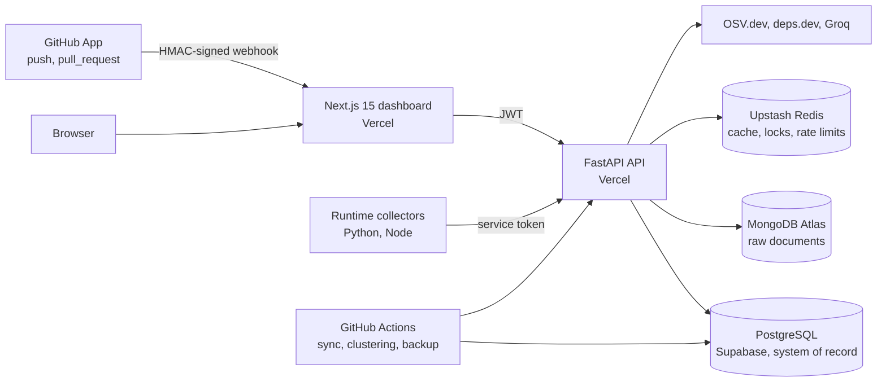

# DephGraph: Tracing Transitive Dependency Vulnerabilities

Software supply-chain risk intelligence. DephGraph stores every service's full dependency graph and tells
you which packages are vulnerable, which never run, which are redundant or copyleft, which are at risk of
abandonment, and which few upgrades fix the most services.

[](https://github.com/Rohith-sp/DephGraph/actions/workflows/ci.yml)


| | |
|---|---|
| Dashboard | https://dephgraph-loki.vercel.app |
| API | https://dephgraph-loki-api.vercel.app (`GET /health` returns `200 {"status":"ok"}`) |
| Access | Invite-only. Sign in with GitHub or email; an admin adds you to a team. |

---

## Why DephGraph

Most scanners stop at "this package has a CVE". A security team needs to know more before it can act:

- Which services reach the vulnerable package, and through which transitive path?
- Which dependencies ship to production but never load, so they can simply be removed?
- Which services pull in several packages that do the same job?
- Which upgrades should go first so the fewest changes clear the most exposure?
- Is the dependency a pull request is about to add safe to merge?

DephGraph keeps the whole graph, across every service of an organisation, in a relational database and
answers these questions with SQL and a few targeted algorithms.

## Features

| Capability | How it works |
|---|---|
| **Dependency ingest** | Parses manifests and lockfiles for PyPI, npm, crates.io and Go (see below), including transitive edges from lockfiles. |
| **Vulnerability data** | Advisories from [OSV.dev](https://osv.dev), package metadata and licences from [deps.dev](https://deps.dev); synced daily. |
| **Blast radius** | Recursive CTE over the `depends_on` graph: every service that reaches a vulnerable version, with the path. |
| **Prune** | Runtime collectors report which packages actually load; anything resolved but never executed is flagged. |
| **Minimum remediation** | Greedy set cover picks the smallest set of upgrades that fixes the most services. Plans and their progress are saved per team. |
| **Consolidate** | Packages are embedded (sentence-transformers), reduced with UMAP and clustered with HDBSCAN; services that use several packages from one cluster are flagged as redundant. |
| **Licence and abandonment risk** | Copyleft licences from deps.dev; an abandonment score from maintainer activity (PyPI, npm, crates.io registries) with a publish-date fallback. |
| **PR gate** | Three stages per added dependency: (1) fast exit for known-clean versions, (2) a SQL rule table over CVSS, copyleft, abandonment and semantic redundancy, (3) an LLM review (Groq, `openai/gpt-oss-120b`) of `ADVISORY` results that may only keep or escalate the verdict, never downgrade it to `PASS`. Results are posted as GitHub Check Runs. |
| **GitHub integration** | A GitHub App imports a service's manifests on push, posts PR Check Runs and opens issues for new vulnerability alerts. |

### Supported inputs

| Ecosystem | Manifests | Lockfiles |
|---|---|---|
| PyPI | `requirements.txt`, `pyproject.toml` | `uv.lock`, `poetry.lock` |
| npm | `package.json` | `package-lock.json` (v2/v3), `pnpm-lock.yaml`, `yarn.lock` |
| crates.io | `Cargo.toml` | `Cargo.lock` |
| Go | `go.mod` | |

Runtime collectors for Python and Node live in [`collectors/`](collectors/README.md). Each is a single
dependency-free file that reports loaded packages to `POST /runtime/samples` with a service token.

## Architecture



- **PostgreSQL** is the system of record: 31 tables (the 23 core tables from the ER design plus 8
  operational ones), views for derived values and row-level security. Schema changes are numbered
  migrations `001`–`017` in [`apps/api/migrations/`](apps/api/migrations), applied by `scripts/migrate.py`.
- **MongoDB** holds the raw layer: `raw_manifests`, `osv_advisories`, `package_embeddings`,
  `runtime_samples` and `review_responses`. Data flows one way, from MongoDB into PostgreSQL, and a stored
  manifest can be re-projected with `POST /ingest/replay/{id}`.
- **Redis** caches read endpoints (invalidated by a generation counter on every write), LLM replies and
  team memberships, and holds rate-limit counters and job locks.

## Tech stack

| Layer | Technology |
|---|---|
| Frontend | Next.js 15, React 19, TypeScript, Tailwind CSS, shadcn/ui, React Flow, Recharts |
| Backend | FastAPI, SQLAlchemy 2 (async), Pydantic v2, structlog |
| Data | PostgreSQL (Supabase), MongoDB Atlas M0, Upstash Redis |
| Auth | Supabase Auth (GitHub sign-in and email) |
| Clustering | sentence-transformers, UMAP, HDBSCAN (batch job `apps/api/app/jobs/cluster.py`) |
| PR gate LLM | Groq, `openai/gpt-oss-120b` |
| Hosting | Vercel (two projects, region `bom1`), GitHub Actions for schedules |
| Monorepo | npm workspaces, Turborepo |

## Quick start (local)

Needs Docker with Compose.

```bash
git clone https://github.com/Rohith-sp/DephGraph.git
cd DephGraph
docker compose up -d --build --wait
```

This starts PostgreSQL, MongoDB and Redis, an `init` step that applies migrations, seeds an empty
database and mints a development token, the API on http://localhost:8000 and the dashboard on
http://localhost:3000. All ports bind to `127.0.0.1`; the local web container runs without Supabase
auth, so do not expose it.

```bash
docker compose --profile ml run --rm cluster   # optional: clustering job (larger ML image)
docker compose down                            # stop, keep data
docker compose down -v                         # stop and wipe data
```

Ports can be moved with `PG_PORT`, `MONGO_PORT`, `REDIS_PORT`, `API_PORT` and `WEB_PORT`. Every
environment variable is documented in [`.env.example`](.env.example).

### With real sign-in (local Supabase)

To run the full product with Supabase Auth locally, install the
[Supabase CLI](https://supabase.com/docs/guides/local-development) and run `supabase start` from the repo
root. It applies `apps/api/migrations` through the `supabase/migrations` link and keeps its own migration
history, so do not run `scripts/migrate.py` against that database. Copy the values from
`supabase status -o env` into the gitignored `.env.local` files, then `scripts/demo.py` seeds the
database, creates a demo user and walks through the whole product. The demo runbook is in
[docs/DEMO.md](docs/DEMO.md).

## Deployment

Production runs on Vercel (web and API as two projects in Mumbai, `bom1`), Supabase, MongoDB Atlas and
Upstash Redis. GitHub Actions handles everything scheduled:

| Workflow | Purpose |
|---|---|
| `ci.yml` | Backend tests with coverage gate, schema check, generated API types, collector tests, lint, typecheck, build, Playwright |
| `cron.yml` | Daily OSV sync, weekly maintainer sync, keep-alive ping for the free-tier databases |
| `cluster.yml` | Daily semantic clustering job (also dispatched on demand from the API) |
| `retry.yml` | Retries failed PR-gate deliveries every 10 minutes |
| `backup.yml` | Weekly encrypted PostgreSQL dump |
| `audit.yml` | Weekly and on-change vulnerability scan of DephGraph's own dependencies |

Step-by-step setup, the access model, smoke tests and restore instructions are in
[docs/DEPLOY.md](docs/DEPLOY.md).

## Security

- **Invite-only teams.** Only organisation admins create teams; team admins invite members by email.
- **Tenant isolation.** Every read and write is scoped to the caller's teams, backed by PostgreSQL
  row-level security.
- **Authentication.** Supabase JWTs are verified on every request; collectors use per-service tokens.
- **Webhooks and internal jobs.** GitHub webhooks are verified with HMAC signatures; internal routes need a
  shared cron secret.
- **Hardening.** Rate limiting, Content-Security-Policy and HSTS headers, and production configuration
  guards: the API refuses to start in production with a default secret or a database URL that points at
  localhost.
- **Secrets** are never committed; configuration comes from environment variables and gitignored
  `.env.local` files.

## Testing and quality

| Suite | Result on current `main` |
|---|---|
| Backend (pytest) | 744 passed, 4 skipped |
| Backend coverage | 97.66 % (CI fails below 70 %) |
| End-to-end (Playwright) | 46 passed |
| CI | green |

```bash
scripts/test_api.sh                    # backend tests in the API image, isolated test database per run
cd apps/web && npx playwright test     # e2e, against a built and running web app
```

## Project structure

```
DephGraph/
├── apps/
│   ├── api/                 FastAPI backend: routers, services, jobs, migrations, tests
│   └── web/                 Next.js 15 dashboard
├── collectors/              Runtime collectors (Python, Node)
├── scripts/                 Migrations runner, seeding, dev tokens, demo, test runner, MySQL helpers
├── supabase/                Local Supabase configuration
├── docs/                    Deploy, demo, coursework and status documents
├── er-diagram/              ER model, diagrams, MySQL course schema
├── relational-model/        ER-to-relational mapping
├── normalization/           Functional dependencies, normal forms
├── relational-algebra/      Constraints and relational algebra queries
├── sql/                     Course SQL: seed data, constraint demos, queries
├── transactions/            Transactions and concurrency
├── .github/workflows/       CI and scheduled jobs
└── docker-compose.yml       Full local stack
```

## Documentation

| Document | Contents |
|---|---|
| [DephGraph_BUILD_PRD.md](DephGraph_BUILD_PRD.md) | Product requirements, architecture and build phases |
| [docs/DEPLOY.md](docs/DEPLOY.md) | Production deployment, access model, backups |
| [docs/DEMO.md](docs/DEMO.md) | Demo runbook |
| [docs/COURSEWORK.md](docs/COURSEWORK.md) | Course phases 4 to 6: SQL, transactions, NoSQL |
| [docs/NEXT_STEPS.md](docs/NEXT_STEPS.md) | Current status and open items |
| [collectors/README.md](collectors/README.md) | Runtime collector setup |

## Course project

DephGraph is the course project for Database Management Systems (CD252IA) at RV College of Engineering.
The database design was done first and the application was built on it. The MySQL 8.4 course schema has
the same 23 core tables; the mapping to the PostgreSQL product schema is in
[er-diagram/README.md](er-diagram/README.md#course-schema-and-product-schema).

| Phase | Folder |
|---|---|
| ER model (14 entities, 16 relationships, recursive `DEPENDS_ON`, ternary `OBSERVES`) | [er-diagram/](er-diagram/) |
| ER-to-relational mapping (23 relations) | [relational-model/](relational-model/) |
| Normalization (all relations in BCNF) | [normalization/](normalization/) |
| Constraints and relational algebra | [relational-algebra/](relational-algebra/) |
| SQL implementation | [sql/](sql/README.md) |
| Transactions and concurrency | [transactions/](transactions/README.md) |


## Team

- Rakshak S (1RV24CS220)
- Rohith Kumar L (1RV24CS233)
- Rohith S Panchamukhi (1RV24CS234)

Guide: Dr. Pratiba D, Associate Professor, Department of CSE, RV College of Engineering.
