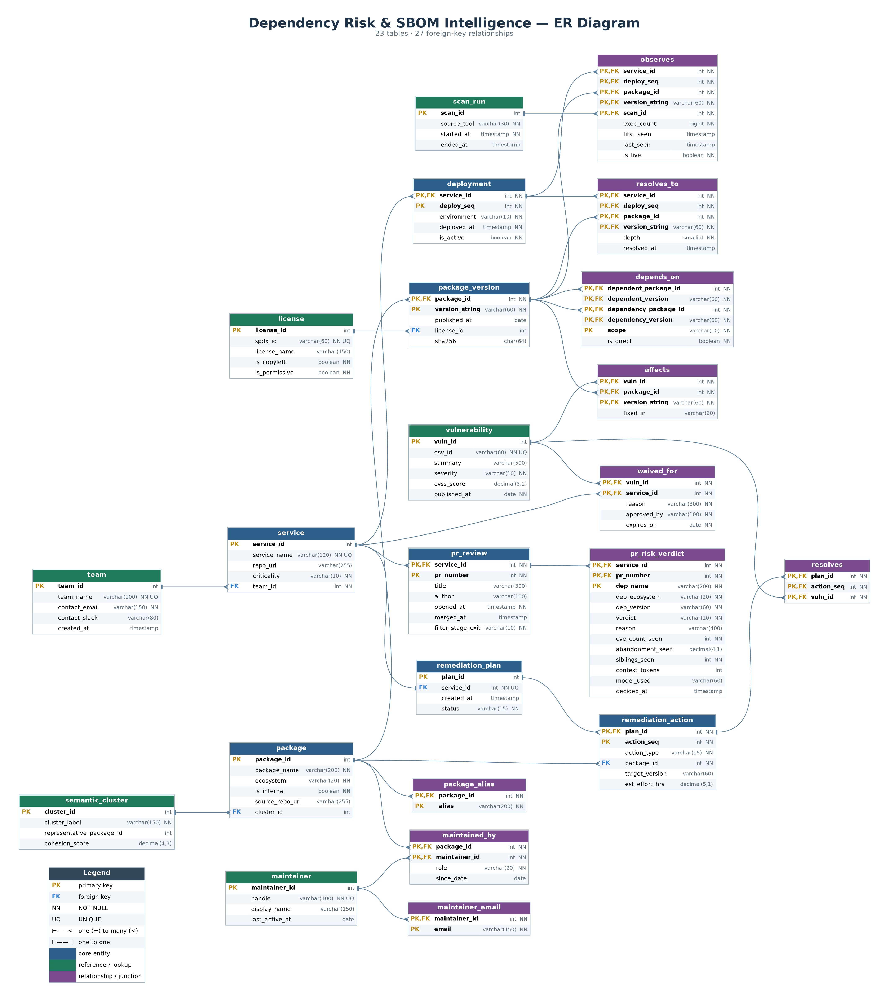

# DephGraph

**Software supply-chain risk intelligence.**

> Every tool tells you which packages have vulnerabilities. DephGraph tells you which ones you can delete, which ones are redundant, and which single upgrade fixes the most services, across the whole organisation.

DephGraph ingests dependency manifests (`requirements.txt`, `package.json`, `Cargo.toml`, `go.mod`) from many services, stores the complete dependency graph in a relational database, and pulls real vulnerability data from [OSV.dev](https://osv.dev) and [deps.dev](https://deps.dev). On top of that graph it answers the questions a security team actually has to act on.



---

## What it answers

| Question | How |
|---|---|
| **Blast radius**: which services reach this vulnerable package, and through which path? | Recursive CTE over the `depends_on` graph |
| **Prune**: which dependencies ship to production but never execute? | Anti-join between resolved packages and runtime observations |
| **Minimum remediation**: which upgrades clear the most CVEs across the most services? | Greedy set cover |
| **License propagation**: does copyleft code reach a shipped service? | Transitive closure joined with licence data |
| **Consolidate**: which services pull in several packages that do the same job? | Semantic clustering of packages (SBERT, UMAP, HDBSCAN) |
| **PR gate**: is the dependency this pull request adds safe? | 3-stage filter: manifest check, SQL verdict, LLM advisory |

---

## Database design

The core of the project is a 23-table relational schema designed from a Chen ER model.

- 14 entities, 5 of them weak (`deployment`, `package_version`, `remediation_action`, `pr_review`, `pr_risk_verdict`)
- A recursive M:N relationship, `DEPENDS_ON`, on `package_version`
- A ternary relationship, `OBSERVES` (deployment × package version × scan window), for runtime liveness evidence
- Multivalued attributes (`package_alias`, `maintainer_email`) and derived attributes computed as views

The full ER diagrams, the relational mapping and the SQL schema are in [`er-diagram/`](er-diagram/).

---

## Planned tech stack

| Layer | Technology |
|---|---|
| Frontend | Next.js 15, TypeScript, Tailwind CSS, shadcn/ui, ReactFlow, Recharts |
| Backend | FastAPI, SQLAlchemy 2 (async), Pydantic v2 |
| Primary database | PostgreSQL (Supabase); MySQL 8 schema for the DBMS coursework |
| Document store and cache | MongoDB Atlas, Upstash Redis |
| Clustering | sentence-transformers, UMAP, HDBSCAN |
| PR gate LLM | Groq (LLaMA 3.1 70B) |
| Hosting | Vercel (frontend), Render (API), cron-job.org (scheduled syncs) |

---

## Repository layout

```
DephGraph/
├── DephGraph_BUILD_PRD.md     # Product requirements, architecture and build phases
└── er-diagram/
    ├── README.md              # ER model explained: entities, relationships, mapping
    ├── schema.sql             # MySQL 8 schema: 23 tables, views, signature queries
    ├── er_crowsfoot.mmd       # Crow's-foot diagram (Mermaid)
    ├── er_chen.mmd            # Chen diagram (Mermaid)
    ├── er_chen.drawio         # Chen diagram, editable
    ├── er_chen_overview.drawio
    └── images/                # Rendered ER diagrams
```

---

## Try the schema

```bash
mysql -u root -p < er-diagram/schema.sql
```

This creates the `dephgraph` database with all tables, constraints and views. The five signature queries are at the end of `schema.sql`.

---

## Status

The project is in the **design phase**. The ER model, relational schema and build plan are done. The application (ingestion pipeline, analysis engine, dashboard and PR gate) will be built in the phases listed in [`DephGraph_BUILD_PRD.md`](DephGraph_BUILD_PRD.md).

| Phase | Scope | Status |
|---|---|---|
| ER model and schema | 23 tables, views, signature queries | Done |
| Setup | Repo, cloud accounts, CI | Planned |
| Ingestion | Manifest parsing, OSV and deps.dev sync | Planned |
| Analysis | Blast radius, set cover, prune, licence propagation | Planned |
| Dashboard | Next.js UI with interactive dependency graph | Planned |
| Clustering | Semantic package clusters | Planned |
| PR gate | GitHub Checks integration | Planned |
