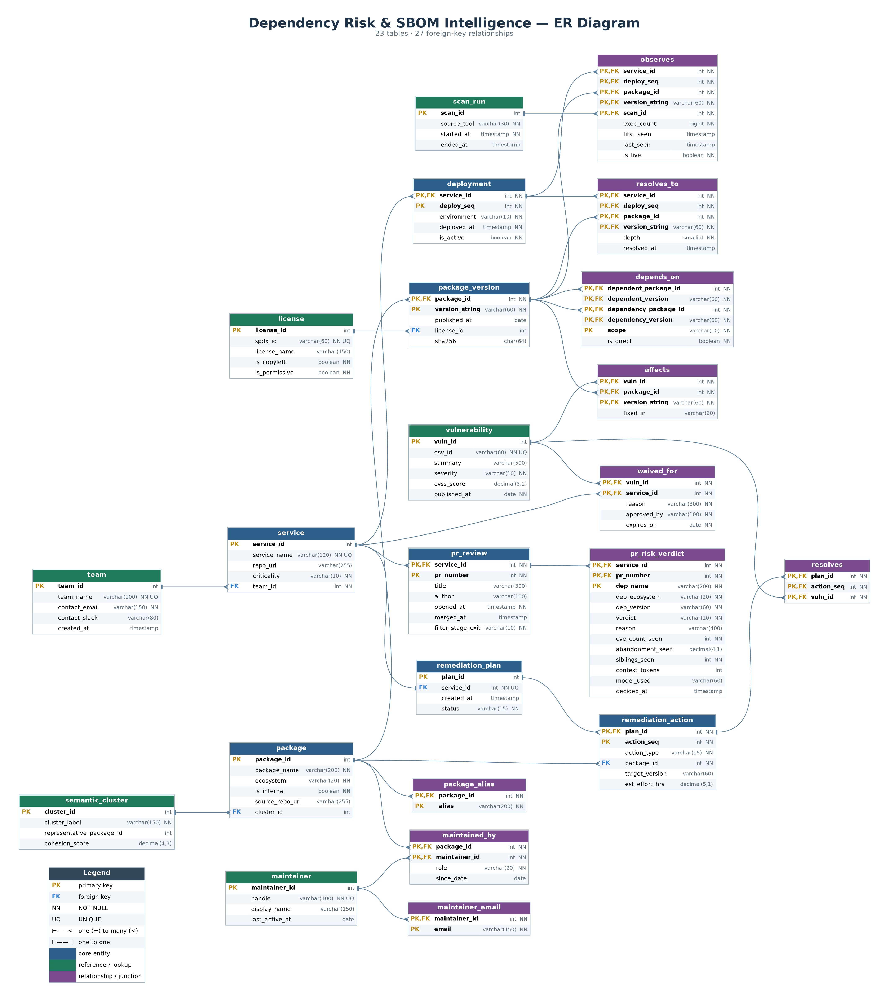

# DephGraph — ER Diagram

Database design for **DephGraph**, a software supply-chain risk intelligence platform.
It stores the full dependency graph of an organisation's services and answers questions such as
*"which services reach this vulnerable package?"*, *"which dependencies are never executed and can be deleted?"*
and *"which single upgrade fixes the most services?"*.

**At a glance:** 14 entities (5 weak) · 16 relationships · 23 relational tables · 1 recursive relationship · 1 ternary relationship · 2 multivalued attributes · 3 derived-attribute views.



---

## Files in this folder

| File | What it is | How to open |
|---|---|---|
| `schema.sql` | Physical schema (MySQL 8.0+): all 23 tables, keys, constraints, indexes, derived-attribute views and the 5 signature queries | MySQL Workbench → *File → Open SQL Script → Run*, then *Database → Reverse Engineer* to regenerate the EER diagram |
| `er_crowsfoot.mmd` | Crow's-foot diagram with every column, PK/FK and cardinality | Renders on GitHub (below) or at [mermaid.live](https://mermaid.live) |
| `er_chen.mmd` | Conceptual Chen-notation diagram (entities, attributes, relationships) | [mermaid.live](https://mermaid.live) |
| `er_chen.drawio` | Editable Chen diagram, full detail | [app.diagrams.net](https://app.diagrams.net) → *Open from device* |
| `er_chen_overview.drawio` | Editable Chen diagram, entities and relationships only | [app.diagrams.net](https://app.diagrams.net) |
| `images/er_diagram_full.png` | Rendered relational diagram with data types | any image viewer |
| `images/er_diagram_compact.png` | Rendered key-only diagram (PK/FK links) | any image viewer |
| `images/er_diagram_dbdiagram_full.png` | dbdiagram.io render, all columns with types | any image viewer |
| `images/er_diagram_dbdiagram_keys.png` | dbdiagram.io render, keys only | any image viewer |

---

## Crow's-foot diagram

```mermaid
erDiagram
    %% DephGraph — crow's-foot ER diagram (matches schema.sql, 23 tables)

    TEAM ||--o{ SERVICE : owns
    TEAM ||--o{ REMEDIATION_PLAN : raises
    SERVICE ||--o{ DEPLOYMENT : "deployed as"
    SERVICE ||--o{ PR_REVIEW : targets
    SERVICE ||--o{ WAIVED_FOR : "waiver for"
    PACKAGE ||--o{ PACKAGE_VERSION : "has version"
    PACKAGE ||--o{ PACKAGE_ALIAS : "known as"
    PACKAGE ||--o{ MAINTAINED_BY : "maintained by"
    MAINTAINER ||--o{ MAINTAINED_BY : maintains
    MAINTAINER ||--o{ MAINTAINER_EMAIL : "reached at"
    SEMANTIC_CLUSTER |o--o{ PACKAGE : groups
    LICENSE |o--o{ PACKAGE_VERSION : licenses
    PACKAGE_VERSION ||--o{ DEPENDS_ON : dependent
    PACKAGE_VERSION ||--o{ DEPENDS_ON : dependency
    DEPLOYMENT ||--o{ RESOLVES_TO : "resolves to"
    PACKAGE_VERSION ||--o{ RESOLVES_TO : "resolved in"
    DEPLOYMENT ||--o{ OBSERVES : observed
    PACKAGE_VERSION ||--o{ OBSERVES : observed
    SCAN_RUN ||--o{ OBSERVES : during
    VULNERABILITY ||--o{ AFFECTS : affects
    PACKAGE_VERSION ||--o{ AFFECTS : "affected by"
    VULNERABILITY ||--o{ WAIVED_FOR : waived
    REMEDIATION_PLAN ||--o{ REMEDIATION_ACTION : contains
    REMEDIATION_ACTION ||--o{ RESOLVES : resolves
    VULNERABILITY ||--o{ RESOLVES : "resolved by"
    PR_REVIEW ||--o{ PR_RISK_VERDICT : "produces"

    TEAM {
        int team_id PK
        varchar team_name UK
        varchar contact_email
        varchar contact_slack
        timestamp created_at
    }
    SERVICE {
        int service_id PK
        varchar service_name UK
        varchar repo_url
        enum criticality
        int team_id FK
    }
    DEPLOYMENT {
        int service_id PK, FK
        int deploy_seq PK "partial key"
        enum environment
        timestamp deployed_at
        boolean is_active
    }
    LICENSE {
        int license_id PK
        varchar spdx_id UK
        varchar license_name
        boolean is_copyleft
        boolean is_permissive
    }
    PACKAGE {
        int package_id PK
        varchar package_name
        enum ecosystem
        boolean is_internal
        varchar source_repo_url
        int cluster_id FK
    }
    PACKAGE_ALIAS {
        int package_id PK, FK
        varchar alias PK
    }
    PACKAGE_VERSION {
        int package_id PK, FK
        varchar version_string PK "partial key"
        date published_at
        int license_id FK
        char sha256
    }
    MAINTAINER {
        int maintainer_id PK
        varchar handle UK
        varchar display_name
        date last_active_at
    }
    MAINTAINER_EMAIL {
        int maintainer_id PK, FK
        varchar email PK
    }
    MAINTAINED_BY {
        int package_id PK, FK
        int maintainer_id PK, FK
        enum role
        date since_date
    }
    DEPENDS_ON {
        int dependent_package_id PK, FK
        varchar dependent_version PK, FK
        int dependency_package_id PK, FK
        varchar dependency_version PK, FK
        enum scope PK
        boolean is_direct
    }
    RESOLVES_TO {
        int service_id PK, FK
        int deploy_seq PK, FK
        int package_id PK, FK
        varchar version_string PK, FK
        smallint depth
        timestamp resolved_at
    }
    SCAN_RUN {
        int scan_id PK
        enum source_tool
        timestamp started_at
        timestamp ended_at
    }
    OBSERVES {
        int service_id PK, FK
        int deploy_seq PK, FK
        int package_id PK, FK
        varchar version_string PK, FK
        int scan_id PK, FK
        bigint exec_count
        timestamp first_seen
        timestamp last_seen
        boolean is_live "derived"
    }
    SEMANTIC_CLUSTER {
        int cluster_id PK
        varchar cluster_label
        int representative_package_id
        decimal cohesion_score
    }
    VULNERABILITY {
        int vuln_id PK
        varchar osv_id UK
        varchar summary
        enum severity
        decimal cvss_score
        date published_at
    }
    AFFECTS {
        int vuln_id PK, FK
        int package_id PK, FK
        varchar version_string PK, FK
        varchar fixed_in
    }
    WAIVED_FOR {
        int vuln_id PK, FK
        int service_id PK, FK
        varchar reason
        varchar approved_by
        date expires_on
    }
    REMEDIATION_PLAN {
        int plan_id PK
        int team_id FK
        timestamp created_at
        enum status
    }
    REMEDIATION_ACTION {
        int plan_id PK, FK
        int action_seq PK "partial key"
        enum action_type
        varchar target_version
        decimal est_effort_hrs
    }
    RESOLVES {
        int plan_id PK, FK
        int action_seq PK, FK
        int vuln_id PK, FK
    }
    PR_REVIEW {
        int service_id PK, FK
        int pr_number PK "partial key"
        varchar title
        varchar author
        timestamp opened_at
        timestamp merged_at
        enum filter_stage_exit
    }
    PR_RISK_VERDICT {
        int service_id PK, FK
        int pr_number PK, FK
        varchar dep_name PK "partial key"
        enum dep_ecosystem
        varchar dep_version
        enum verdict
        varchar reason
        int cve_count_seen
        decimal abandonment_seen
        int siblings_seen
        int context_tokens
        varchar model_used
        timestamp decided_at
    }
```



---

## Entities

| Entity | Type | Primary key | Purpose |
|---|---|---|---|
| `TEAM` | strong | `team_id` | Engineering team that owns services |
| `SERVICE` | strong | `service_id` | A deployable application / repository |
| `DEPLOYMENT` | **weak** (owner: SERVICE) | `(service_id, deploy_seq)` | One release of a service to DEV / STAGING / PROD |
| `PACKAGE` | strong | `package_id` | An open-source or internal library (npm, PyPI, Maven, Go, crates.io, NuGet) |
| `PACKAGE_VERSION` | **weak** (owner: PACKAGE) | `(package_id, version_string)` | A specific released version of a package |
| `MAINTAINER` | strong | `maintainer_id` | A person who maintains packages |
| `LICENSE` | strong | `license_id` | SPDX licence, flagged copyleft / permissive |
| `SEMANTIC_CLUSTER` | strong | `cluster_id` | Group of packages that do the same job (e.g. "http client") |
| `SCAN_RUN` | strong | `scan_id` | One observation window of a scanner (eBPF agent, manifest parser, OSV sync) |
| `VULNERABILITY` | strong | `vuln_id` | A CVE / GHSA advisory from OSV.dev |
| `REMEDIATION_PLAN` | strong | `plan_id` | A fix plan raised by a team (output of the set-cover solver) |
| `REMEDIATION_ACTION` | **weak** (owner: REMEDIATION_PLAN) | `(plan_id, action_seq)` | One step: UPGRADE / REMOVE / CONSOLIDATE / REPLACE |
| `PR_REVIEW` | **weak** (owner: SERVICE) | `(service_id, pr_number)` | A pull request checked by the PR risk gate |
| `PR_RISK_VERDICT` | **weak** (owner: PR_REVIEW) | `(service_id, pr_number, dep_name)` | Gate verdict for one dependency added by a PR |

## Relationships

| Relationship | Between | Cardinality | Stored as |
|---|---|---|---|
| OWNS | TEAM – SERVICE | 1 : N (total on SERVICE) | FK `service.team_id` |
| DEPLOYED_AS *(identifying)* | SERVICE – DEPLOYMENT | 1 : N | composite PK of `deployment` |
| RAISED_BY | TEAM – REMEDIATION_PLAN | 1 : N (total on REMEDIATION_PLAN) | FK `remediation_plan.team_id` |
| TARGETS *(identifying)* | SERVICE – PR_REVIEW | 1 : N | composite PK of `pr_review` |
| HAS_VERSION *(identifying)* | PACKAGE – PACKAGE_VERSION | 1 : N | composite PK of `package_version` |
| GROUPED_INTO | PACKAGE – SEMANTIC_CLUSTER | N : 1 (partial) | nullable FK `package.cluster_id` |
| LICENSED_UNDER | PACKAGE_VERSION – LICENSE | N : 1 (partial) | nullable FK `package_version.license_id` |
| MAINTAINED_BY | PACKAGE – MAINTAINER | M : N | table `maintained_by` (+ `role`, `since_date`) |
| **DEPENDS_ON** *(recursive)* | PACKAGE_VERSION – PACKAGE_VERSION | M : N | table `depends_on` (roles: dependent → dependency) |
| RESOLVES_TO | DEPLOYMENT – PACKAGE_VERSION | M : N | table `resolves_to` (+ `depth`) |
| **OBSERVES** *(ternary)* | DEPLOYMENT – PACKAGE_VERSION – SCAN_RUN | M : N : P | table `observes` (+ `exec_count`, derived `is_live`) |
| AFFECTS | VULNERABILITY – PACKAGE_VERSION | M : N | table `affects` (+ `fixed_in`) |
| WAIVED_FOR | VULNERABILITY – SERVICE | M : N | table `waived_for` (+ `reason`, `approved_by`, `expires_on`) |
| CONTAINS *(identifying)* | REMEDIATION_PLAN – REMEDIATION_ACTION | 1 : N | composite PK of `remediation_action` |
| RESOLVES | REMEDIATION_ACTION – VULNERABILITY | M : N | table `resolves` |
| PRODUCED_FOR *(identifying)* | PR_REVIEW – PR_RISK_VERDICT | 1 : N | composite PK of `pr_risk_verdict` |

### Why OBSERVES is ternary
A row means *"package version X executed N times in deployment D **during scan window S**"*.
Splitting it into binary relationships loses which observation window produced the evidence,
so "zero executions" could no longer be answered for a specific window.

### Why `pr_risk_verdict.dep_name` has no FK to `package`
A pull request can introduce a package DephGraph has never seen. Forcing the FK would stop
the gate from judging exactly the new dependencies it most needs to judge.

---

## ER → relational mapping

| ER construct | Rule applied | Resulting tables |
|---|---|---|
| Strong entities (9) | one table each, surrogate PK | `team`, `service`, `package`, `maintainer`, `license`, `semantic_cluster`, `scan_run`, `vulnerability`, `remediation_plan` |
| Weak entities (5) | owner's PK + partial key as composite PK, `ON DELETE CASCADE` | `deployment`, `package_version`, `remediation_action`, `pr_review`, `pr_risk_verdict` |
| 1 : N relationships | FK on the N side | no extra table |
| M : N relationships (6) | own table, PK = both FKs | `maintained_by`, `depends_on`, `resolves_to`, `affects`, `waived_for`, `resolves` |
| Ternary relationship (1) | own table, PK = all three FKs | `observes` |
| Multivalued attributes (2) | own table, PK = owner FK + value | `package_alias`, `maintainer_email` |
| Derived attributes | views or generated column, never stored | `v_package_abandonment`, `v_service_exposure`, `v_cluster_redundancy`, `observes.is_live` |

**Total: 9 + 5 + 6 + 1 + 2 = 23 tables.**

---

## Signature queries (`schema.sql`, section 9)

1. **Blast radius**: a recursive CTE walks `depends_on` upward from a vulnerable version to every affected service.
2. **Prune**: packages in `resolves_to` with no live row in `observes`, i.e. shipped but never executed.
3. **Minimum remediation**: greedy set-cover step, the upgrade that clears the most services and CVEs.
4. **License propagation**: copyleft licences that reach a production service.
5. **Consolidate**: clusters holding more than one package that does the same job.

---

## Loading the schema

```bash
mysql -u root -p < schema.sql
```

Then in MySQL Workbench: *Database → Reverse Engineer → pick `dephgraph` → Execute* to get the auto-generated EER diagram.

## Notation used in the Chen diagrams

| Symbol | Meaning |
|---|---|
| Rectangle / double rectangle | Strong / weak entity |
| Diamond / double diamond | Relationship / identifying relationship |
| Ellipse, underlined | Key attribute (dashed underline = partial key) |
| Double ellipse | Multivalued attribute |
| Dashed ellipse | Derived attribute |
| Double line | Total participation |
