# DephGraph — Phase 2: ER to Relational Mapping

Phase 1 produced the **ER model** (see [`../er-diagram/`](../er-diagram/)).
Phase 2 converts that model into a **relational model** (also called the *relational schema*):
a set of relations (tables), each with named attributes (columns), a primary key and foreign keys.

The conversion follows the standard **7-step ER-to-relational mapping algorithm**
(Elmasri & Navathe, *Fundamentals of Database Systems*, Ch. 9). Every relation below comes from
one specific step, so each table can be traced back to a shape in the ER diagram.

---

## Notation

| Mark | Meaning |
|---|---|
| <ins>underlined</ins> | Primary key (PK) attribute |
| *italic* | Foreign key (FK) attribute |
| `A → R(B)` | Attribute `A` references attribute `B` of relation `R` |
| `RELATION(a, b, c)` | Relation schema: relation name followed by its attributes |

---

## Input: the ER model from Phase 1

| | Count | Items |
|---|---|---|
| Strong entities | 9 | TEAM, SERVICE, SCAN_RUN, PACKAGE, LICENSE, MAINTAINER, SEMANTIC_CLUSTER, VULNERABILITY, REMEDIATION_PLAN |
| Weak entities | 5 | DEPLOYMENT, PACKAGE_VERSION, REMEDIATION_ACTION, PR_REVIEW, PR_RISK_VERDICT |
| Identifying 1:N relationships | 5 | DEPLOYED_AS, HAS_VERSION, CONTAINS, TARGETS, PRODUCED_FOR |
| Regular 1:N relationships | 4 | OWNS, RAISED_BY, LICENSED_UNDER, GROUPED_INTO |
| 1:1 relationships | 0 | — |
| M:N relationships | 6 | RESOLVES_TO, DEPENDS_ON (recursive), MAINTAINED_BY, AFFECTS, RESOLVES, WAIVED_FOR |
| Ternary relationships | 1 | OBSERVES |
| Multivalued attributes | 2 | PACKAGE.alias, MAINTAINER.email |
| Composite attributes | 1 | TEAM.contact = (contact_email, contact_slack) |
| Derived attributes | 6 | SERVICE.exposure_score, PACKAGE.abandonment_score, PACKAGE_VERSION.age, SEMANTIC_CLUSTER.member_count, PR_RISK_VERDICT.context_tokens, OBSERVES.is_live |

---

## Step 1 — Map strong entity types

**Rule.** For every strong entity create a relation containing all its *simple* attributes.
A *composite* attribute is replaced by its component attributes. *Multivalued* attributes are left
for Step 6 and *derived* attributes are not stored. The key attribute becomes the primary key.

| ER entity | What happens to its attributes | Relation produced |
|---|---|---|
| TEAM | composite `contact` is split into `contact_email`, `contact_slack` | TEAM(<ins>team_id</ins>, team_name, contact_email, contact_slack) |
| SERVICE | derived `exposure_score` dropped | SERVICE(<ins>service_id</ins>, service_name, criticality) |
| SCAN_RUN | all simple | SCAN_RUN(<ins>scan_id</ins>, source_tool, started_at, ended_at) |
| PACKAGE | multivalued `alias` → Step 6; derived `abandonment_score` dropped | PACKAGE(<ins>package_id</ins>, package_name, ecosystem) |
| LICENSE | all simple | LICENSE(<ins>license_id</ins>, spdx_id, is_copyleft) |
| MAINTAINER | multivalued `email` → Step 6 | MAINTAINER(<ins>maintainer_id</ins>, handle, last_active_at) |
| SEMANTIC_CLUSTER | derived `member_count` dropped | SEMANTIC_CLUSTER(<ins>cluster_id</ins>, cluster_label) |
| VULNERABILITY | all simple | VULNERABILITY(<ins>vuln_id</ins>, osv_id, severity, cvss_score) |
| REMEDIATION_PLAN | all simple | REMEDIATION_PLAN(<ins>plan_id</ins>, status, created_at) |

**Result: 9 relations.** Foreign keys are not added yet; Step 4 adds them.

---

## Step 2 — Map weak entity types

**Rule.** For every weak entity create a relation with its simple attributes, then add the
**primary key of the owner entity** as a foreign key. The primary key of the new relation is
*owner's PK + the weak entity's partial key*. The identifying relationship needs no table of its own:
it is represented by this foreign key. Use `ON DELETE CASCADE`, because a weak entity cannot exist
without its owner.

Owners must be mapped first. PR_RISK_VERDICT is owned by PR_REVIEW, which is itself weak, so
PR_REVIEW is mapped before it and passes on its two-column key.

| Weak entity | Owner (identifying relationship) | Partial key | Relation produced |
|---|---|---|---|
| DEPLOYMENT | SERVICE (DEPLOYED_AS) | deploy_seq | DEPLOYMENT(<ins>*service_id*</ins>, <ins>deploy_seq</ins>, environment, deployed_at, is_active) |
| PACKAGE_VERSION | PACKAGE (HAS_VERSION) | version_string | PACKAGE_VERSION(<ins>*package_id*</ins>, <ins>version_string</ins>, published_at, sha256) |
| REMEDIATION_ACTION | REMEDIATION_PLAN (CONTAINS) | action_seq | REMEDIATION_ACTION(<ins>*plan_id*</ins>, <ins>action_seq</ins>, action_type, target_version) |
| PR_REVIEW | SERVICE (TARGETS) | pr_number | PR_REVIEW(<ins>*service_id*</ins>, <ins>pr_number</ins>, author, opened_at, filter_stage_exit) |
| PR_RISK_VERDICT | PR_REVIEW (PRODUCED_FOR) | dep_name | PR_RISK_VERDICT(<ins>*service_id*</ins>, <ins>*pr_number*</ins>, <ins>dep_name</ins>, verdict, reason) |

Foreign keys created:
- DEPLOYMENT.service_id → SERVICE(service_id)
- PACKAGE_VERSION.package_id → PACKAGE(package_id)
- REMEDIATION_ACTION.plan_id → REMEDIATION_PLAN(plan_id)
- PR_REVIEW.service_id → SERVICE(service_id)
- PR_RISK_VERDICT.(service_id, pr_number) → PR_REVIEW(service_id, pr_number), a *composite* foreign key

PACKAGE_VERSION.age and PR_RISK_VERDICT.context_tokens are derived, so they are not stored.

**Result: 5 relations. Running total: 14.**

---

## Step 3 — Map binary 1:1 relationship types

**Rule.** For a 1:1 relationship, put the primary key of one side as a foreign key in the other
(prefer the side with total participation).

**Our ER model has no 1:1 relationships, so this step produces nothing.**

**Result: 0 relations. Running total: 14.**

---

## Step 4 — Map binary 1:N relationship types

**Rule.** For a regular (non-identifying) 1:N relationship, add the primary key of the **1-side**
as a foreign key in the relation of the **N-side**. Relationship attributes, if any, also go to the
N-side. No new relation is created.

- *Total* participation on the N-side means the foreign key is `NOT NULL`.
- *Partial* participation on the N-side means the foreign key may be `NULL`.

| Relationship | 1-side | N-side | Participation of N-side | Column added |
|---|---|---|---|---|
| OWNS | TEAM | SERVICE | total (a service always has a team) | SERVICE.*team_id* → TEAM, `NOT NULL` |
| RAISED_BY | TEAM | REMEDIATION_PLAN | total (a plan always has a team) | REMEDIATION_PLAN.*team_id* → TEAM, `NOT NULL` |
| LICENSED_UNDER | LICENSE | PACKAGE_VERSION | partial (licence data is often missing) | PACKAGE_VERSION.*license_id* → LICENSE, nullable |
| GROUPED_INTO | SEMANTIC_CLUSTER | PACKAGE | partial (HDBSCAN leaves "noise" packages unclustered) | PACKAGE.*cluster_id* → SEMANTIC_CLUSTER, nullable |

The five identifying 1:N relationships were already handled in Step 2.

Relations after this step:
- SERVICE(<ins>service_id</ins>, service_name, criticality, *team_id*)
- REMEDIATION_PLAN(<ins>plan_id</ins>, status, created_at, *team_id*)
- PACKAGE_VERSION(<ins>*package_id*</ins>, <ins>version_string</ins>, published_at, sha256, *license_id*)
- PACKAGE(<ins>package_id</ins>, package_name, ecosystem, *cluster_id*)

**Result: 0 new relations, 4 foreign keys added. Running total: 14.**

---

## Step 5 — Map binary M:N relationship types

**Rule.** For every M:N relationship create a new relation (a *junction* or *bridge* table).
It contains the primary keys of both participating entities as foreign keys, and together they form
its primary key. Relationship attributes become columns of this relation.

An M:N relationship cannot be stored as a single foreign key, because each side would need to hold
a *list* of keys. That would break first normal form.

| Relationship | Between | Relationship attributes | Relation produced |
|---|---|---|---|
| RESOLVES_TO | DEPLOYMENT – PACKAGE_VERSION | depth | RESOLVES_TO(<ins>*service_id*</ins>, <ins>*deploy_seq*</ins>, <ins>*package_id*</ins>, <ins>*version_string*</ins>, depth) |
| DEPENDS_ON (recursive) | PACKAGE_VERSION – PACKAGE_VERSION | scope, is_direct | DEPENDS_ON(<ins>*dependent_package_id*</ins>, <ins>*dependent_version*</ins>, <ins>*dependency_package_id*</ins>, <ins>*dependency_version*</ins>, scope, is_direct) |
| MAINTAINED_BY | PACKAGE – MAINTAINER | role | MAINTAINED_BY(<ins>*package_id*</ins>, <ins>*maintainer_id*</ins>, role) |
| AFFECTS | PACKAGE_VERSION – VULNERABILITY | fixed_in | AFFECTS(<ins>*package_id*</ins>, <ins>*version_string*</ins>, <ins>*vuln_id*</ins>, fixed_in) |
| RESOLVES | REMEDIATION_ACTION – VULNERABILITY | — | RESOLVES(<ins>*plan_id*</ins>, <ins>*action_seq*</ins>, <ins>*vuln_id*</ins>) |
| WAIVED_FOR | VULNERABILITY – SERVICE | expires_on | WAIVED_FOR(<ins>*vuln_id*</ins>, <ins>*service_id*</ins>, expires_on) |

Notes:
- When a participating entity is **weak**, its whole composite key is carried over. That is why
  RESOLVES_TO carries `(service_id, deploy_seq)` from DEPLOYMENT and `(package_id, version_string)`
  from PACKAGE_VERSION.
- **DEPENDS_ON is recursive**: both foreign keys point to the same relation, PACKAGE_VERSION.
  The two copies of the key are renamed by **role**, `dependent_*` (the version that needs something)
  and `dependency_*` (the version it needs), so the column names do not clash.

**Result: 6 relations. Running total: 20.**

---

## Step 6 — Map multivalued attributes

**Rule.** For every multivalued attribute create a new relation containing the attribute and the
primary key of the entity it belongs to (as a foreign key). The primary key is the combination of both.

| Multivalued attribute | Relation produced |
|---|---|
| PACKAGE.alias | PACKAGE_ALIAS(<ins>*package_id*</ins>, <ins>alias</ins>) |
| MAINTAINER.email | MAINTAINER_EMAIL(<ins>*maintainer_id*</ins>, <ins>email</ins>) |

Keeping `alias` inside PACKAGE would need a list in one cell (`"log4j2, log4j-core"`), which
violates first normal form.

**Result: 2 relations. Running total: 22.**

---

## Step 7 — Map n-ary relationship types (n > 2)

**Rule.** For every relationship of degree n > 2 create a new relation. It contains the primary keys
of **all** participating entities as foreign keys, plus the relationship's attributes. The primary key
is the combination of all the foreign keys.

| Relationship | Participants | Relationship attributes | Relation produced |
|---|---|---|---|
| OBSERVES (ternary) | DEPLOYMENT, SCAN_RUN, PACKAGE_VERSION | exec_count (is_live is derived) | OBSERVES(<ins>*service_id*</ins>, <ins>*deploy_seq*</ins>, <ins>*scan_id*</ins>, <ins>*package_id*</ins>, <ins>*version_string*</ins>, exec_count) |

OBSERVES is kept as one ternary relation instead of three binary ones. A row states
*"this package version ran `exec_count` times in this deployment **during this scan window**"*.
If it were split into binary relations, it would no longer be possible to say which scan window
produced which count.

**Result: 1 relation. Running total: 23.**

---

## Step 8 — Specialization / generalization

The ER model has no superclass/subclass hierarchies, so this step does not apply.

---

## Summary of the mapping

| Step | Construct | Relations created | Running total |
|---|---|---|---|
| 1 | Strong entities | 9 | 9 |
| 2 | Weak entities | 5 | 14 |
| 3 | 1:1 relationships | 0 | 14 |
| 4 | 1:N relationships | 0 (4 FKs added) | 14 |
| 5 | M:N relationships | 6 | 20 |
| 6 | Multivalued attributes | 2 | 22 |
| 7 | Ternary relationship | 1 | **23** |

**14 entities and 16 relationships become 23 relations.**

---

## Final relational schema

1. TEAM(<ins>team_id</ins>, team_name, contact_email, contact_slack)
2. SERVICE(<ins>service_id</ins>, service_name, criticality, *team_id*)
3. SCAN_RUN(<ins>scan_id</ins>, source_tool, started_at, ended_at)
4. PACKAGE(<ins>package_id</ins>, package_name, ecosystem, *cluster_id*)
5. LICENSE(<ins>license_id</ins>, spdx_id, is_copyleft)
6. MAINTAINER(<ins>maintainer_id</ins>, handle, last_active_at)
7. SEMANTIC_CLUSTER(<ins>cluster_id</ins>, cluster_label)
8. VULNERABILITY(<ins>vuln_id</ins>, osv_id, severity, cvss_score)
9. REMEDIATION_PLAN(<ins>plan_id</ins>, status, created_at, *team_id*)
10. DEPLOYMENT(<ins>*service_id*</ins>, <ins>deploy_seq</ins>, environment, deployed_at, is_active)
11. PACKAGE_VERSION(<ins>*package_id*</ins>, <ins>version_string</ins>, published_at, sha256, *license_id*)
12. REMEDIATION_ACTION(<ins>*plan_id*</ins>, <ins>action_seq</ins>, action_type, target_version)
13. PR_REVIEW(<ins>*service_id*</ins>, <ins>pr_number</ins>, author, opened_at, filter_stage_exit)
14. PR_RISK_VERDICT(<ins>*service_id*</ins>, <ins>*pr_number*</ins>, <ins>dep_name</ins>, verdict, reason)
15. RESOLVES_TO(<ins>*service_id*</ins>, <ins>*deploy_seq*</ins>, <ins>*package_id*</ins>, <ins>*version_string*</ins>, depth)
16. DEPENDS_ON(<ins>*dependent_package_id*</ins>, <ins>*dependent_version*</ins>, <ins>*dependency_package_id*</ins>, <ins>*dependency_version*</ins>, scope, is_direct)
17. MAINTAINED_BY(<ins>*package_id*</ins>, <ins>*maintainer_id*</ins>, role)
18. AFFECTS(<ins>*package_id*</ins>, <ins>*version_string*</ins>, <ins>*vuln_id*</ins>, fixed_in)
19. RESOLVES(<ins>*plan_id*</ins>, <ins>*action_seq*</ins>, <ins>*vuln_id*</ins>)
20. WAIVED_FOR(<ins>*vuln_id*</ins>, <ins>*service_id*</ins>, expires_on)
21. PACKAGE_ALIAS(<ins>*package_id*</ins>, <ins>alias</ins>)
22. MAINTAINER_EMAIL(<ins>*maintainer_id*</ins>, <ins>email</ins>)
23. OBSERVES(<ins>*service_id*</ins>, <ins>*deploy_seq*</ins>, <ins>*scan_id*</ins>, <ins>*package_id*</ins>, <ins>*version_string*</ins>, exec_count)

### Referential integrity constraints (all foreign keys)

| # | Relation.attribute(s) | References | Comes from |
|---|---|---|---|
| 1 | SERVICE.team_id | TEAM(team_id) | Step 4, OWNS |
| 2 | REMEDIATION_PLAN.team_id | TEAM(team_id) | Step 4, RAISED_BY |
| 3 | PACKAGE.cluster_id | SEMANTIC_CLUSTER(cluster_id) | Step 4, GROUPED_INTO |
| 4 | PACKAGE_VERSION.license_id | LICENSE(license_id) | Step 4, LICENSED_UNDER |
| 5 | DEPLOYMENT.service_id | SERVICE(service_id) | Step 2, DEPLOYED_AS |
| 6 | PACKAGE_VERSION.package_id | PACKAGE(package_id) | Step 2, HAS_VERSION |
| 7 | REMEDIATION_ACTION.plan_id | REMEDIATION_PLAN(plan_id) | Step 2, CONTAINS |
| 8 | PR_REVIEW.service_id | SERVICE(service_id) | Step 2, TARGETS |
| 9 | PR_RISK_VERDICT.(service_id, pr_number) | PR_REVIEW(service_id, pr_number) | Step 2, PRODUCED_FOR |
| 10 | RESOLVES_TO.(service_id, deploy_seq) | DEPLOYMENT(service_id, deploy_seq) | Step 5 |
| 11 | RESOLVES_TO.(package_id, version_string) | PACKAGE_VERSION(package_id, version_string) | Step 5 |
| 12 | DEPENDS_ON.(dependent_package_id, dependent_version) | PACKAGE_VERSION(package_id, version_string) | Step 5 |
| 13 | DEPENDS_ON.(dependency_package_id, dependency_version) | PACKAGE_VERSION(package_id, version_string) | Step 5 |
| 14 | MAINTAINED_BY.package_id | PACKAGE(package_id) | Step 5 |
| 15 | MAINTAINED_BY.maintainer_id | MAINTAINER(maintainer_id) | Step 5 |
| 16 | AFFECTS.(package_id, version_string) | PACKAGE_VERSION(package_id, version_string) | Step 5 |
| 17 | AFFECTS.vuln_id | VULNERABILITY(vuln_id) | Step 5 |
| 18 | RESOLVES.(plan_id, action_seq) | REMEDIATION_ACTION(plan_id, action_seq) | Step 5 |
| 19 | RESOLVES.vuln_id | VULNERABILITY(vuln_id) | Step 5 |
| 20 | WAIVED_FOR.vuln_id | VULNERABILITY(vuln_id) | Step 5 |
| 21 | WAIVED_FOR.service_id | SERVICE(service_id) | Step 5 |
| 22 | PACKAGE_ALIAS.package_id | PACKAGE(package_id) | Step 6 |
| 23 | MAINTAINER_EMAIL.maintainer_id | MAINTAINER(maintainer_id) | Step 6 |
| 24 | OBSERVES.(service_id, deploy_seq) | DEPLOYMENT(service_id, deploy_seq) | Step 7 |
| 25 | OBSERVES.scan_id | SCAN_RUN(scan_id) | Step 7 |
| 26 | OBSERVES.(package_id, version_string) | PACKAGE_VERSION(package_id, version_string) | Step 7 |

### Where the derived attributes went

Derived attributes are computed when queried, never stored as base columns:

| Derived attribute | Computed from |
|---|---|
| SERVICE.exposure_score | count of unwaived vulnerabilities reachable through RESOLVES_TO and AFFECTS |
| PACKAGE.abandonment_score | number of maintainers and their last_active_at, via MAINTAINED_BY |
| PACKAGE_VERSION.age | today − published_at |
| SEMANTIC_CLUSTER.member_count | `COUNT(*)` of PACKAGE rows with that cluster_id |
| PR_RISK_VERDICT.context_tokens | size of the prompt sent to the LLM at stage 3 |
| OBSERVES.is_live | exec_count > 0 |

---

## Relational schema diagram

Each box is a relation; each line is a foreign key pointing from the referencing relation to the
referenced one. This diagram renders directly on GitHub. The same source is in
[`relational_schema.mmd`](relational_schema.mmd).

```mermaid
erDiagram
    %% DephGraph relational schema: the 23 relations produced by the ER-to-relational mapping

    TEAM ||--o{ SERVICE : "team_id"
    TEAM ||--o{ REMEDIATION_PLAN : "team_id"
    SEMANTIC_CLUSTER |o--o{ PACKAGE : "cluster_id"
    LICENSE |o--o{ PACKAGE_VERSION : "license_id"
    SERVICE ||--o{ DEPLOYMENT : "service_id"
    PACKAGE ||--o{ PACKAGE_VERSION : "package_id"
    REMEDIATION_PLAN ||--o{ REMEDIATION_ACTION : "plan_id"
    SERVICE ||--o{ PR_REVIEW : "service_id"
    PR_REVIEW ||--o{ PR_RISK_VERDICT : "service_id, pr_number"
    DEPLOYMENT ||--o{ RESOLVES_TO : "service_id, deploy_seq"
    PACKAGE_VERSION ||--o{ RESOLVES_TO : "package_id, version_string"
    PACKAGE_VERSION ||--o{ DEPENDS_ON : "dependent_*"
    PACKAGE_VERSION ||--o{ DEPENDS_ON : "dependency_*"
    PACKAGE ||--o{ MAINTAINED_BY : "package_id"
    MAINTAINER ||--o{ MAINTAINED_BY : "maintainer_id"
    PACKAGE_VERSION ||--o{ AFFECTS : "package_id, version_string"
    VULNERABILITY ||--o{ AFFECTS : "vuln_id"
    REMEDIATION_ACTION ||--o{ RESOLVES : "plan_id, action_seq"
    VULNERABILITY ||--o{ RESOLVES : "vuln_id"
    VULNERABILITY ||--o{ WAIVED_FOR : "vuln_id"
    SERVICE ||--o{ WAIVED_FOR : "service_id"
    PACKAGE ||--o{ PACKAGE_ALIAS : "package_id"
    MAINTAINER ||--o{ MAINTAINER_EMAIL : "maintainer_id"
    DEPLOYMENT ||--o{ OBSERVES : "service_id, deploy_seq"
    SCAN_RUN ||--o{ OBSERVES : "scan_id"
    PACKAGE_VERSION ||--o{ OBSERVES : "package_id, version_string"

    TEAM {
        int team_id PK
        varchar team_name
        varchar contact_email
        varchar contact_slack
    }
    SERVICE {
        int service_id PK
        varchar service_name
        varchar criticality
        int team_id FK
    }
    SCAN_RUN {
        int scan_id PK
        varchar source_tool
        timestamp started_at
        timestamp ended_at
    }
    PACKAGE {
        int package_id PK
        varchar package_name
        varchar ecosystem
        int cluster_id FK
    }
    LICENSE {
        int license_id PK
        varchar spdx_id
        boolean is_copyleft
    }
    MAINTAINER {
        int maintainer_id PK
        varchar handle
        date last_active_at
    }
    SEMANTIC_CLUSTER {
        int cluster_id PK
        varchar cluster_label
    }
    VULNERABILITY {
        int vuln_id PK
        varchar osv_id
        varchar severity
        decimal cvss_score
    }
    REMEDIATION_PLAN {
        int plan_id PK
        varchar status
        timestamp created_at
        int team_id FK
    }
    DEPLOYMENT {
        int service_id PK, FK
        int deploy_seq PK
        varchar environment
        timestamp deployed_at
        boolean is_active
    }
    PACKAGE_VERSION {
        int package_id PK, FK
        varchar version_string PK
        date published_at
        char sha256
        int license_id FK
    }
    REMEDIATION_ACTION {
        int plan_id PK, FK
        int action_seq PK
        varchar action_type
        varchar target_version
    }
    PR_REVIEW {
        int service_id PK, FK
        int pr_number PK
        varchar author
        timestamp opened_at
        varchar filter_stage_exit
    }
    PR_RISK_VERDICT {
        int service_id PK, FK
        int pr_number PK, FK
        varchar dep_name PK
        varchar verdict
        varchar reason
    }
    RESOLVES_TO {
        int service_id PK, FK
        int deploy_seq PK, FK
        int package_id PK, FK
        varchar version_string PK, FK
        int depth
    }
    DEPENDS_ON {
        int dependent_package_id PK, FK
        varchar dependent_version PK, FK
        int dependency_package_id PK, FK
        varchar dependency_version PK, FK
        varchar scope
        boolean is_direct
    }
    MAINTAINED_BY {
        int package_id PK, FK
        int maintainer_id PK, FK
        varchar role
    }
    AFFECTS {
        int package_id PK, FK
        varchar version_string PK, FK
        int vuln_id PK, FK
        varchar fixed_in
    }
    RESOLVES {
        int plan_id PK, FK
        int action_seq PK, FK
        int vuln_id PK, FK
    }
    WAIVED_FOR {
        int vuln_id PK, FK
        int service_id PK, FK
        date expires_on
    }
    PACKAGE_ALIAS {
        int package_id PK, FK
        varchar alias PK
    }
    MAINTAINER_EMAIL {
        int maintainer_id PK, FK
        varchar email PK
    }
    OBSERVES {
        int service_id PK, FK
        int deploy_seq PK, FK
        int scan_id PK, FK
        int package_id PK, FK
        varchar version_string PK, FK
        int exec_count
    }
```

---

## The tables with sample rows

The same 23 relations shown as tables (rows and columns), filled with a small consistent example:
a `payments-svc` service that pulls in the vulnerable `log4j-core 2.14.1` (Log4Shell) through
`spring-boot-starter-log4j2`. Foreign-key values match across tables, so every row can be
followed from one table to the next. The data is made up for illustration.

PK columns are underlined; FK columns are in italics.

### 1. TEAM
| <ins>team_id</ins> | team_name | contact_email | contact_slack |
|---|---|---|---|
| 1 | Payments | payments@example.com | #payments |
| 2 | Platform | platform@example.com | #platform |

### 2. SERVICE
| <ins>service_id</ins> | service_name | criticality | *team_id* |
|---|---|---|---|
| 10 | payments-svc | HIGH | 1 |
| 11 | auth-svc | CRITICAL | 2 |

### 3. SCAN_RUN
| <ins>scan_id</ins> | source_tool | started_at | ended_at |
|---|---|---|---|
| 500 | ebpf-agent | 2026-08-01 00:00 | 2026-08-31 00:00 |
| 501 | osv-sync | 2026-09-01 02:00 | 2026-09-01 02:04 |

### 4. PACKAGE
| <ins>package_id</ins> | package_name | ecosystem | *cluster_id* |
|---|---|---|---|
| 100 | log4j-core | Maven | 3 |
| 101 | logback-classic | Maven | 3 |
| 102 | spring-boot-starter-log4j2 | Maven | NULL |

### 5. LICENSE
| <ins>license_id</ins> | spdx_id | is_copyleft |
|---|---|---|
| 1 | Apache-2.0 | FALSE |
| 2 | LGPL-2.1-only | TRUE |

### 6. MAINTAINER
| <ins>maintainer_id</ins> | handle | last_active_at |
|---|---|---|
| 200 | mdev | 2026-10-15 |
| 201 | kpatel | 2025-08-02 |

### 7. SEMANTIC_CLUSTER
| <ins>cluster_id</ins> | cluster_label |
|---|---|
| 3 | logging |
| 4 | http client |

### 8. VULNERABILITY
| <ins>vuln_id</ins> | osv_id | severity | cvss_score |
|---|---|---|---|
| 900 | GHSA-jfh8-c2jp-5v3q | CRITICAL | 10.0 |
| 901 | GHSA-7rjr-3q55-vv33 | CRITICAL | 9.0 |

### 9. REMEDIATION_PLAN
| <ins>plan_id</ins> | status | created_at | *team_id* |
|---|---|---|---|
| 50 | ACTIVE | 2026-10-01 | 1 |
| 51 | DRAFT | 2026-10-12 | 2 |

### 10. DEPLOYMENT
| <ins>*service_id*</ins> | <ins>deploy_seq</ins> | environment | deployed_at | is_active |
|---|---|---|---|---|
| 10 | 1 | PROD | 2026-09-01 10:00 | TRUE |
| 10 | 2 | STAGING | 2026-10-05 16:30 | TRUE |

### 11. PACKAGE_VERSION
| <ins>*package_id*</ins> | <ins>version_string</ins> | published_at | sha256 | *license_id* |
|---|---|---|---|---|
| 100 | 2.14.1 | 2021-03-06 | 9f2c…e41a | 1 |
| 100 | 2.17.1 | 2021-12-27 | 4b8d…a07c | 1 |
| 101 | 1.2.3 | 2017-03-31 | c51e…77d2 | 2 |
| 102 | 2.5.0 | 2021-05-20 | 0ad3…9be5 | 1 |

### 12. REMEDIATION_ACTION
| <ins>*plan_id*</ins> | <ins>action_seq</ins> | action_type | target_version |
|---|---|---|---|
| 50 | 1 | UPGRADE | 2.17.1 |
| 50 | 2 | REMOVE | NULL |

### 13. PR_REVIEW
| <ins>*service_id*</ins> | <ins>pr_number</ins> | author | opened_at | filter_stage_exit |
|---|---|---|---|---|
| 10 | 42 | alice | 2026-10-20 11:05 | STAGE_2 |
| 11 | 7 | bob | 2026-10-21 09:40 | STAGE_1 |

### 14. PR_RISK_VERDICT
| <ins>*service_id*</ins> | <ins>*pr_number*</ins> | <ins>dep_name</ins> | verdict | reason |
|---|---|---|---|---|
| 10 | 42 | log4j-core | RISK | CVSS 10.0, fix available in 2.17.1 |
| 10 | 42 | gson | APPROVE | no known vulnerabilities |

### 15. RESOLVES_TO
| <ins>*service_id*</ins> | <ins>*deploy_seq*</ins> | <ins>*package_id*</ins> | <ins>*version_string*</ins> | depth |
|---|---|---|---|---|
| 10 | 1 | 102 | 2.5.0 | 0 |
| 10 | 1 | 100 | 2.14.1 | 1 |
| 10 | 1 | 101 | 1.2.3 | 0 |

### 16. DEPENDS_ON
| <ins>*dependent_package_id*</ins> | <ins>*dependent_version*</ins> | <ins>*dependency_package_id*</ins> | <ins>*dependency_version*</ins> | scope | is_direct |
|---|---|---|---|---|---|
| 102 | 2.5.0 | 100 | 2.14.1 | runtime | TRUE |

### 17. MAINTAINED_BY
| <ins>*package_id*</ins> | <ins>*maintainer_id*</ins> | role |
|---|---|---|
| 100 | 200 | OWNER |
| 101 | 201 | OWNER |

### 18. AFFECTS
| <ins>*package_id*</ins> | <ins>*version_string*</ins> | <ins>*vuln_id*</ins> | fixed_in |
|---|---|---|---|
| 100 | 2.14.1 | 900 | 2.15.0 |
| 100 | 2.14.1 | 901 | 2.16.0 |

### 19. RESOLVES
| <ins>*plan_id*</ins> | <ins>*action_seq*</ins> | <ins>*vuln_id*</ins> |
|---|---|---|
| 50 | 1 | 900 |
| 50 | 1 | 901 |

### 20. WAIVED_FOR
| <ins>*vuln_id*</ins> | <ins>*service_id*</ins> | expires_on |
|---|---|---|
| 901 | 10 | 2026-11-30 |

### 21. PACKAGE_ALIAS
| <ins>*package_id*</ins> | <ins>alias</ins> |
|---|---|
| 100 | log4j2 |
| 100 | org.apache.logging.log4j:log4j-core |

### 22. MAINTAINER_EMAIL
| <ins>*maintainer_id*</ins> | <ins>email</ins> |
|---|---|
| 200 | mdev@example.com |
| 200 | mdev@example.org |
| 201 | kpatel@example.com |

### 23. OBSERVES
| <ins>*service_id*</ins> | <ins>*deploy_seq*</ins> | <ins>*scan_id*</ins> | <ins>*package_id*</ins> | <ins>*version_string*</ins> | exec_count |
|---|---|---|---|---|---|
| 10 | 1 | 500 | 100 | 2.14.1 | 1840 |
| 10 | 1 | 500 | 101 | 1.2.3 | 0 |

### Reading the example across tables

- `payments-svc` (SERVICE 10) is deployed to PROD (DEPLOYMENT 10/1).
- That deployment directly uses `spring-boot-starter-log4j2 2.5.0` (RESOLVES_TO depth 0), which
  depends on `log4j-core 2.14.1` (DEPENDS_ON), so log4j-core is reached at depth 1.
- `log4j-core 2.14.1` is affected by two critical vulnerabilities (AFFECTS 900 and 901).
- Remediation plan 50, action 1 (UPGRADE to 2.17.1) clears both of them (RESOLVES): one action,
  two CVEs, which is exactly the M:N that set cover optimises.
- During scan window 500, log4j-core ran 1840 times but `logback-classic` ran 0 times (OBSERVES),
  so logback-classic is a candidate for removal. It is also in the same "logging" cluster as
  log4j-core (PACKAGE.cluster_id = 3), so it is redundant as well.
- `spring-boot-starter-log4j2` has cluster_id NULL: a noise point, allowed because
  GROUPED_INTO has partial participation.
