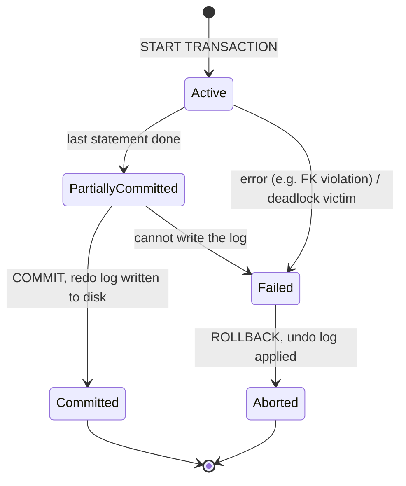
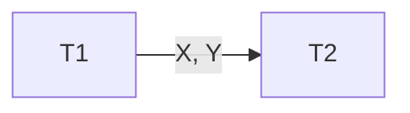
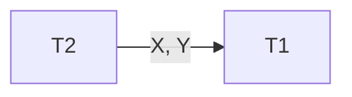
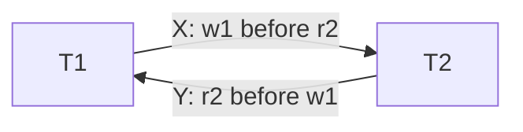
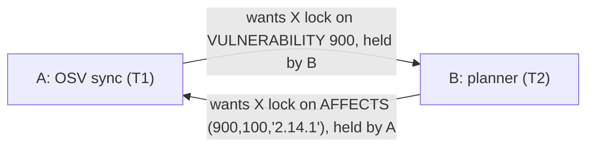

# DephGraph — Phase 5: Transactions and Concurrency Control

This covers **Unit IV** of the syllabus for the DephGraph schema:

1. **Transactions**: what one is in DephGraph, its states, and the ACID properties
2. **Schedules**: serial, non-serial, conflict serializability and precedence graphs
3. **Concurrency control**: two-phase locking (2PL), lock modes, deadlocks
4. **Isolation levels**: dirty, non-repeatable and phantom reads

Every claim about MySQL below was run for real on MySQL 8.4.13 (InnoDB) with the 23 tables of
[`er-diagram/schema.sql`](../er-diagram/schema.sql) and the Phase 2 sample rows of
[`sql/seed.sql`](../sql/seed.sql) (payments-svc runs the vulnerable log4j-core 2.14.1, Log4Shell is
vulnerability 900, remediation plan 50). The outputs are copied from the log files and trimmed to
the lines that matter: table borders and some echoed statements are left out, long statements are
shortened with `...`, and text after `<-` is a note added here, not program output. How to rerun
everything is in [the last section](#how-to-rerun-the-demos).

Files of this phase:

| File | What it is |
|---|---|
| [`sql/tx_ingest_demo.sql`](../sql/tx_ingest_demo.sql) | one session: atomic manifest ingest, ROLLBACK, COMMIT, SAVEPOINT, autocommit |
| [`scripts/tx_two_sessions.sh`](../scripts/tx_two_sessions.sh) | runs 2–3 MySQL sessions at the same time and merges their output by time |
| [`sql/tx/`](../sql/tx/) | the SQL of each session, one file per session (`<demo>_a.sql`, `<demo>_b.sql`, …) |

Earlier phases: [Phase 1 ER model](../er-diagram/README.md) ·
[Phase 2 relational mapping](../relational-model/README.md) ·
[Phase 3a normalization](../normalization/README.md) ·
[Phase 3b constraints and relational algebra](../relational-algebra/README.md).

---

# Part 1 — Transactions in DephGraph

## 1.1 What a transaction is

A **transaction** is a group of database operations that must happen as one unit: either all of
them take effect, or none of them do. Three DephGraph jobs show why this matters.

| Job | What it reads and writes | Why it must be one unit |
|---|---|---|
| **Manifest ingest** | inserts one DEPLOYMENT row and one RESOLVES_TO row per resolved package version | a deployment with only half of its packages makes blast-radius and exposure answers silently wrong |
| **OSV sync** | updates VULNERABILITY (severity, CVSS) and AFFECTS (`fixed_in`) from new advisories | an advisory is one fact: its score and its affected versions must change together |
| **Remediation plan generation** | reads AFFECTS, RESOLVES_TO, VULNERABILITY; inserts REMEDIATION_PLAN, REMEDIATION_ACTION, RESOLVES | the plan must be built from one consistent picture of the vulnerabilities, and the plan rows must be stored together |

The real app (Postgres, in `apps/api`) does exactly this:

- `POST /ingest/manifest` (`apps/api/app/routers/ingest.py`) opens one transaction with
  `async with session.begin():` around storing the packages, the advisories, the deployment, the
  RESOLVES_TO rows and the SCAN_RUN row. Any exception rolls all of it back.
- The same transaction first calls `lock_service`, which takes `pg_advisory_xact_lock(service_id)`:
  a lock held until commit, so two ingests for the same service run one after the other.
- `POST /internal/osv-sync` writes VULNERABILITY and AFFECTS in one transaction.
- `POST /remediation/plan` writes the plan, its actions and the RESOLVES rows, then commits once.

The course demos below use **MySQL** on the course schema, because that is the schema of Phases 1–3.
The ideas are the same in Postgres; small differences are noted where they matter.

## 1.2 Read and write operations

In the theory a transaction is a list of two kinds of operations on data items:

- `r(X)`: read item X from the database
- `w(X)`: write item X to the database

plus `c` (commit) or `a` (abort) at the end. A data item here is one row. For the ingest:

```
T_ingest:  w(DEPLOYMENT(10,3))  w(RESOLVES_TO(10,3,102,'2.5.0'))  w(RESOLVES_TO(10,3,101,'1.2.3'))
           w(RESOLVES_TO(10,3,100,'2.17.1'))  c
```

## 1.3 Transaction states



| State | In the ingest demo (Part 3) |
|---|---|
| **Active** | after `START TRANSACTION`, while the DEPLOYMENT and RESOLVES_TO rows are inserted |
| **Partially committed** | the last INSERT has run, but `COMMIT` has not finished yet |
| **Committed** | `COMMIT` returned: the rows are permanent and visible to others |
| **Failed** | the INSERT with log4j-core 2.99.0 broke the foreign key `fk_rt_version` |
| **Aborted** | `ROLLBACK` undid the deployment row and the good RESOLVES_TO rows |

After an abort the job can be **restarted** (a deadlock victim, Part 6) or **killed** (a bad
lockfile: the user has to fix it first).

---

# Part 2 — ACID

| Property | Meaning | DephGraph example | How MySQL/InnoDB provides it |
|---|---|---|---|
| **Atomicity** | all or nothing | an ingest with one bad package version stores nothing at all (Part 3, demo a) | every change is first written to the **undo log**; `ROLLBACK`, a crash or a deadlock uses it to restore the old row versions |
| **Consistency** | a transaction takes the database from one valid state to another | the FK `fk_rt_version` rejects a RESOLVES_TO row for a version that is not in PACKAGE_VERSION; `chk_depth` rejects depth < 0; together with atomicity no half-stored deployment can exist | the constraints of `schema.sql` (PK, UNIQUE, FK, CHECK, ENUM), checked on every statement; rules that span rows (a deployment must have all its packages) are kept by the application using transactions |
| **Isolation** | concurrent transactions do not see each other's half-done work | a dashboard reading VULNERABILITY 900 does not see an uncommitted wrong severity written by an OSV sync (Part 7) | **row locks** for writes and locking reads (strict 2PL, Part 5) plus **MVCC** consistent snapshots for plain reads; the isolation level chooses how much is hidden |
| **Durability** | once committed, it stays, even after a crash | after the ingest `COMMIT`, deployment 3 survives a server crash | at `COMMIT` the **redo log** is flushed to disk (`innodb_flush_log_at_trx_commit = 1` on our server); after a crash InnoDB replays it. The doublewrite buffer (`innodb_doublewrite = ON`) protects against half-written pages |

The server settings quoted above were read from the course container:

```
+-----------------+---------------+-----------+------+-----------------+-------+--------+-------------+
| flush_at_commit | rb_on_timeout | dl_detect | lwt  | iso             | dblwr | binlog | sync_binlog |
+-----------------+---------------+-----------+------+-----------------+-------+--------+-------------+
|               1 |             0 |         1 |   50 | REPEATABLE-READ | ON    |      1 |           1 |
+-----------------+---------------+-----------+------+-----------------+-------+--------+-------------+
```

(`rb_on_timeout` = `innodb_rollback_on_timeout`, `dl_detect` = `innodb_deadlock_detect`,
`lwt` = `innodb_lock_wait_timeout` in seconds, `iso` = default isolation level.)

Durability was not tested by crashing the server, because the course container is shared with
other work. It is explained, not demonstrated.

---

# Part 3 — Demo: one manifest ingest is one transaction

File: [`sql/tx_ingest_demo.sql`](../sql/tx_ingest_demo.sql), output `logs/tx_ingest_demo.log`.
A new lockfile for payments-svc (service 10) becomes deployment 3. At the start the database holds
the seed rows: 2 deployments and 3 RESOLVES_TO rows.

## (a) A row fails half-way → ROLLBACK → nothing stored

The lockfile names log4j-core 2.99.0, which is not in PACKAGE_VERSION.

```
START TRANSACTION
INSERT INTO deployment (service_id, deploy_seq, environment, deployed_at, is_active)
VALUES (10, 3, 'PROD', '2026-11-01 10:00:00', TRUE)
Query OK, 1 row affected

INSERT INTO resolves_to (service_id, deploy_seq, package_id, version_string, depth)
VALUES (10, 3, 102, '2.5.0', 0),
       (10, 3, 101, '1.2.3', 0)
Query OK, 2 rows affected

INSERT INTO resolves_to (service_id, deploy_seq, package_id, version_string, depth)
VALUES (10, 3, 100, '2.17.1', 1),
       (10, 3, 100, '2.99.0', 1)
ERROR 1452 (23000) at line 64: Cannot add or update a child row: a foreign key constraint fails
(`dephgraph`.`resolves_to`, CONSTRAINT `fk_rt_version` FOREIGN KEY (`package_id`, `version_string`)
REFERENCES `package_version` (`package_id`, `version_string`) ON DELETE CASCADE)

+----------------------------------------------+--------------+--------------------+
| state                                        | deployment_3 | resolves_to_rows_3 |
+----------------------------------------------+--------------+--------------------+
| inside the open transaction, after the error |            1 |                  2 |
+----------------------------------------------+--------------+--------------------+

ROLLBACK
+----------------+--------------+--------------------+
| state          | deployment_3 | resolves_to_rows_3 |
+----------------+--------------+--------------------+
| after ROLLBACK |            0 |                  0 |
+----------------+--------------+--------------------+
```

Two things to notice:

1. **MySQL does not roll back the transaction by itself when a statement fails.** It undoes only
   the failed statement (both rows of the third INSERT are gone, including the good 2.17.1 row:
   one statement is atomic on its own). The transaction stays **open** with the deployment row
   and the first two RESOLVES_TO rows still in it. The client must send `ROLLBACK`. In the app
   this is SQLAlchemy's `session.begin()` block: an exception inside it makes it roll back.
   (Postgres is stricter: after an error it refuses every further statement until `ROLLBACK`.)
2. Inside its own transaction a session sees its own uncommitted rows (count 1 and 2 above).

## (b) All rows fine → COMMIT → rows stored

Same lockfile with log4j-core 2.17.1 (the upgrade of remediation plan 50):

```
START TRANSACTION
INSERT INTO deployment ... VALUES (10, 3, 'PROD', '2026-11-01 10:00:00', TRUE)   -- 1 row affected
INSERT INTO resolves_to ... (10,3,102,'2.5.0',0), (10,3,101,'1.2.3',0), (10,3,100,'2.17.1',1)  -- 3 rows affected
COMMIT

+------------+------------+-------------+----------------------------+----------------+-------+
| service_id | deploy_seq | environment | package_name               | version_string | depth |
+------------+------------+-------------+----------------------------+----------------+-------+
|         10 |          3 | PROD        | logback-classic            | 1.2.3          |     0 |
|         10 |          3 | PROD        | spring-boot-starter-log4j2 | 2.5.0          |     0 |
|         10 |          3 | PROD        | log4j-core                 | 2.17.1         |     1 |
+------------+------------+-------------+----------------------------+----------------+-------+

+---------------------------------+-------+
| check_name                      | found |
+---------------------------------+-------+
| vulnerable rows in deployment 3 |     0 |
+---------------------------------+-------+
```

## (c) SAVEPOINT: undo only part of a transaction

Deployment 4 stores its direct dependencies, sets a savepoint, then tries the transitive ones.
The first try has a bad version, so the job goes back to the savepoint and tries again.

```
START TRANSACTION
INSERT INTO deployment ... (10, 4, 'STAGING', ...)                         -- 1 row
INSERT INTO resolves_to ... (10,4,102,'2.5.0',0), (10,4,101,'1.2.3',0)      -- 2 rows
SAVEPOINT direct_deps_done
INSERT INTO resolves_to ... VALUES (10, 4, 100, '2.14.1', 1)               -- 1 row
INSERT INTO resolves_to ... VALUES (10, 4, 100, '2.99.0', 2)
ERROR 1452 (23000) at line 142: Cannot add or update a child row: a foreign key constraint fails ...
| before ROLLBACK TO SAVEPOINT |                  3 |
ROLLBACK TO SAVEPOINT direct_deps_done
| after ROLLBACK TO SAVEPOINT |            1 |                  2 |      <- deployment kept, direct rows kept
INSERT INTO resolves_to ... VALUES (10, 4, 100, '2.17.1', 1)               -- 1 row
COMMIT
|          4 | logback-classic            | 1.2.3          |     0 |
|          4 | spring-boot-starter-log4j2 | 2.5.0          |     0 |
|          4 | log4j-core                 | 2.17.1         |     1 |
```

## (d) autocommit

With `autocommit = 1` (the MySQL default) every statement outside `START TRANSACTION` is a
transaction of its own and is committed at once.

```
| autocommit_now | 1 |
INSERT INTO deployment ... (10, 5, 'DEV', ...)      -- 1 row affected
ROLLBACK
| autocommit=1, INSERT then ROLLBACK        | deployment_5_rows  = 1 |   <- ROLLBACK could not undo it

INSERT INTO resolves_to ... (10,5,102,'2.5.0',0), (10,5,100,'2.99.0',1)
ERROR 1452 (23000) at line 189: ...
| autocommit=1, one INSERT of 2 rows, 1 bad | resolves_to_rows_5 = 0 |   <- still all-or-nothing per statement

SET autocommit = 0
INSERT INTO deployment ... (10, 6, 'DEV', ...)      -- 1 row affected
ROLLBACK
| autocommit=0, INSERT then ROLLBACK        | deployment_6_rows  = 0 |   <- a transaction had started by itself
SET autocommit = 1
```

At the end the script deletes deployments 3–5 (ON DELETE CASCADE removes their RESOLVES_TO rows)
and shows `deployments = 2, resolves_to_rows = 3`, the same as after `seed.sql`.

---

# Part 4 — Schedules and conflict serializability

## 4.1 The two transactions

Two DephGraph jobs run at the same time and touch the same two rows:

- **X** = AFFECTS row (900, 100, '2.14.1'): Log4Shell affects log4j-core 2.14.1, `fixed_in` = 2.15.0
- **Y** = VULNERABILITY row 900: Log4Shell, severity CRITICAL, CVSS 10.0

| Transaction | Job | Operations |
|---|---|---|
| **T1** | OSV sync applies a revised advisory: new `fixed_in`, new CVSS | r1(X) w1(X) r1(Y) w1(Y) c1 |
| **T2** | remediation planner: reads the severity to rank the vulnerability, then `fixed_in` to choose the upgrade target | r2(Y) r2(X) c2 |

A **schedule** is an order of the operations of several transactions that keeps the order inside
each transaction.

Two operations **conflict** when (1) they belong to different transactions, (2) they use the same
item, and (3) at least one of them is a write. So the conflicting pairs here are:

| Pair | Type |
|---|---|
| w1(X) and r2(X) | write–read on X |
| w1(Y) and r2(Y) | write–read on Y |
| r1(X) and r2(X), r1(Y) and r2(Y) | not conflicts (both reads) |

The **precedence graph** of a schedule has one node per transaction and an edge Ti → Tj when an
operation of Ti comes before a conflicting operation of Tj. A schedule is **conflict serializable**
exactly when this graph has **no cycle**; the equivalent serial order is then a topological order of
the graph.

## 4.2 Schedule S1 — serial

```
S1:  r1(X) w1(X) r1(Y) w1(Y) c1  r2(Y) r2(X) c2
```

| Conflicting pair | Order in S1 | Edge |
|---|---|---|
| w1(X), r2(X) | w1(X) first | T1 → T2 |
| w1(Y), r2(Y) | w1(Y) first | T1 → T2 |



No cycle. S1 is serial (T1 then T2), so it is correct by definition: the planner sees the new
`fixed_in` and the new CVSS together.

## 4.3 Schedule S2 — non-serial but conflict serializable

```
S2:  r1(X) r2(Y) r2(X) c2 w1(X) r1(Y) w1(Y) c1
```

The OSV sync has started (it read X), then the planner runs completely, then the sync writes.

| Conflicting pair | Order in S2 | Edge |
|---|---|---|
| r2(X), w1(X) | r2(X) first | T2 → T1 |
| r2(Y), w1(Y) | r2(Y) first | T2 → T1 |



No cycle, so S2 is **conflict serializable**. Swapping adjacent non-conflicting operations
(r1(X) with r2(Y), r2(X) and c2: all different items or both reads) turns it into the serial
schedule **T2 → T1**:

```
r2(Y) r2(X) c2  r1(X) w1(X) r1(Y) w1(Y) c1
```

The planner sees the old advisory completely (old `fixed_in`, old CVSS). That is a consistent,
if older, picture.

## 4.4 Schedule S3 — not serializable

```
S3:  r1(X) w1(X) r2(Y) r2(X) c2 r1(Y) w1(Y) c1
```

| Conflicting pair | Order in S3 | Edge |
|---|---|---|
| w1(X), r2(X) | w1(X) first | T1 → T2 |
| r2(Y), w1(Y) | r2(Y) first | T2 → T1 |



The graph has the cycle T1 → T2 → T1, so S3 is **not conflict serializable**. No serial order gives
its result: the planner read the **new** `fixed_in` (written by T1) but the **old** CVSS (before T1
wrote it). It ranks the vulnerability with a score that never belonged to that `fixed_in`. This is
the *inconsistent analysis* problem.

S3 has two more faults. T2 reads X after T1 wrote it but before T1 committed: a **dirty read**.
And T2 commits before T1: if T1 then aborts, T2 has already committed a plan based on a value that
never existed, so S3 is also **not recoverable**.

## 4.5 The classic anomalies, in DephGraph terms

| Anomaly | What happens | DephGraph example | Seen in demo |
|---|---|---|---|
| **Lost update** | two transactions read the same value, both write back a new value computed from it; the first write is lost | two engineers each add 2 h to the estimate of remediation action (50, 1): 4.0 → 6.0 instead of 8.0 | `lostupdate`, Part 7.4 |
| **Dirty read** (temporary update) | T2 reads a value written by T1 before T1 commits; T1 then aborts | a dashboard shows Log4Shell as MEDIUM 5.0 while an OSV sync that later rolls back is running | `dirtyread`, Part 7.1 |
| **Unrepeatable read** | T2 reads the same item twice and gets different values because T1 committed a change in between | a planner reads `fixed_in` = 2.15.0, then 2.17.1, in one transaction | `nonrepeatable`, Part 7.2 |
| **Phantom** | T2 runs the same query twice and new rows appear | the count of AFFECTS rows for vulnerability 900 goes from 1 to 2 inside one transaction | `nonrepeatable`, Part 7.2 |
| **Incorrect summary / inconsistent analysis** | T2 computes over items while T1 changes some of them | schedule S3 above | `deadlock` prevents it, Part 6 |

---

# Part 5 — Two-phase locking

## 5.1 Locks and the compatibility matrix

A transaction must hold a lock on an item before it uses it:

- **shared lock S(X)** (read lock) before r(X); many transactions may hold S on the same item
- **exclusive lock X(X)** (write lock) before w(X); only one transaction may hold it, and nobody
  else may hold S at the same time

| Held \ Requested | S | X |
|---|---|---|
| **S** | yes | no (wait) |
| **X** | no (wait) | no (wait) |

A transaction that holds S and wants to write **upgrades** S to X. InnoDB also puts **intention
locks** on the whole table first: IS before a shared row lock, IX before an exclusive row lock.
Intention locks are compatible with each other; they only conflict with whole-table S/X locks
(such as `LOCK TABLES`). That is the `TABLE | IX` row in every `data_locks` output below.

In MySQL:

| SQL | Row lock taken |
|---|---|
| `SELECT ...` (plain) | none: reads a snapshot (MVCC), see 5.5 |
| `SELECT ... FOR SHARE` | S |
| `SELECT ... FOR UPDATE` | X |
| `UPDATE`, `DELETE`, `INSERT` | X (on the rows written) |

## 5.2 The two-phase rule

**Two-phase locking (2PL):** in every transaction, all lock operations come before the first
unlock operation. So each transaction has two phases:

1. **Growing phase**: it may take locks (and upgrade them), but not release any.
2. **Shrinking phase**: it may release locks (and downgrade them), but not take any new one.

The moment the last lock is taken is the transaction's **lock point**.

**Why 2PL guarantees conflict serializability.** Suppose the precedence graph has an edge
Ti → Tj on item Z. Then Ti used Z first, released its lock on Z, and only then could Tj lock Z. So Ti
released a lock before Tj took one, which means lock_point(Ti) < lock_point(Tj). A cycle
T1 → T2 → … → T1 would give lock_point(T1) < lock_point(T1), which is impossible. So the graph has
no cycle, and the schedule is equivalent to the serial order of the lock points.

## 5.3 Basic, conservative, strict and rigorous 2PL

| Variant | Rule | Gives | Problem left |
|---|---|---|---|
| **Basic 2PL** | growing then shrinking | conflict serializability | cascading aborts (others may read X after it is unlocked but before commit), deadlocks |
| **Conservative (static) 2PL** | take every lock before the first operation | no deadlocks | must know the read/write set in advance; rarely used |
| **Strict 2PL** | basic 2PL + hold all **exclusive** locks until commit/abort | strict schedules: no dirty reads, no cascading aborts, easy recovery | deadlocks |
| **Rigorous 2PL** | basic 2PL + hold **all** locks (S and X) until commit/abort | as strict; and the serial order is the commit order | deadlocks |

**InnoDB uses rigorous 2PL for the rows it locks**: every row lock taken by UPDATE, DELETE, INSERT,
`FOR UPDATE` or `FOR SHARE` is kept until `COMMIT` or `ROLLBACK`. There is no statement to release
one row lock early. (One small exception: under READ COMMITTED, InnoDB releases the locks on rows
that an UPDATE or DELETE scanned but did not match.)

## 5.4 2PL applied to the schedules of Part 4

Under strict (or rigorous) 2PL each read first takes S, each write takes X (upgrading an S the
transaction already holds), and nothing is released before commit:

```
T1:  S1(X) r1(X)  X1(X) w1(X)  S1(Y) r1(Y)  X1(Y) w1(Y)  c1 [release all]
T2:  S2(Y) r2(Y)  S2(X) r2(X)  c2 [release all]
```

**S1** (serial) runs without any waiting.

**S2 under 2PL.** Follow S2 step by step:

| Step | Operation in S2 | Lock request | Result |
|---|---|---|---|
| 1 | r1(X) | S1(X) | granted |
| 2 | r2(Y) | S2(Y) | granted |
| 3 | r2(X) | S2(X) | granted: S is compatible with T1's S1(X) |
| 4 | c2 | release S2(Y), S2(X) | T2 ends |
| 5 | w1(X) | upgrade to X1(X) | granted: nobody else holds X now |
| 6 | r1(Y) w1(Y) | S1(Y), X1(Y) | granted |
| 7 | c1 | release all | T1 ends |

2PL lets S2 run exactly as written. Its lock points are in the order T2, T1, which is the serial
order T2 → T1 found from the precedence graph.

**S3 under 2PL.** Follow S3 step by step:

| Step | Operation in S3 | Lock request | Result |
|---|---|---|---|
| 1 | r1(X) w1(X) | S1(X), upgrade to X1(X) | granted |
| 2 | r2(Y) | S2(Y) | granted |
| 3 | r2(X) | S2(X) | **waits**: T1 holds X1(X) until it commits |
| 4 | r1(Y) | S1(Y) | granted: S is compatible with S2(Y) |
| 5 | w1(Y) | upgrade to X1(Y) | **waits**: T2 holds S2(Y) until it commits |

Now T1 waits for T2 and T2 waits for T1: a **deadlock**. 2PL never lets the non-serializable
schedule S3 happen; the price is that one of the two transactions has to be aborted and restarted,
after which the other one finishes and the result is a serial order. This is exactly what the
`deadlock` demo runs on MySQL (Part 6.2). The demo takes the X locks at once (UPDATE and
`FOR UPDATE`) instead of S then upgrade; the cycle is the same.

## 5.5 How InnoDB really does it: locks + MVCC

InnoDB mixes two methods:

- **Writes and locking reads** (UPDATE, DELETE, INSERT, `FOR UPDATE`, `FOR SHARE`) use row locks
  under rigorous 2PL. The locks are on index records. Under REPEATABLE READ a range search also
  takes **next-key locks** (the record plus the gap before it) and **gap locks**, so no other
  transaction can insert a row into a range that was read: this stops phantoms for locking reads.
  An equality search on a unique key locks only the one record (`X,REC_NOT_GAP` below).
- **Plain SELECTs** take no locks at all. They read a **consistent snapshot** built from the undo
  log (multi-version concurrency control, MVCC). Readers never block writers and writers never
  block readers. Under REPEATABLE READ the snapshot is taken at the first read of the transaction
  and kept until it ends; under READ COMMITTED a new snapshot is taken for every statement.

So the 2PL theory applies to the locking statements, and the isolation level decides what the
plain reads see. Part 7 shows both side by side.

---

# Part 6 — Two concurrent sessions on MySQL

[`scripts/tx_two_sessions.sh`](../scripts/tx_two_sessions.sh) starts 2 or 3 `mysql` clients at the
same moment, each running its own file from [`sql/tx/`](../sql/tx/). The script chooses a start
time T0; every session waits with `DO SLEEP` until "t = x s" before each step, so the steps happen in
the same order on every run. Each output line starts with the time in seconds after T0 (when the
statement **finished**) and the session name. Every session sets `innodb_lock_wait_timeout = 5`,
so nothing can hang. Each demo ends with ROLLBACK or a compensating update, and the script compares
`CHECKSUM TABLE` before and after (`data restored: yes`).

Each demo was run at least five times; apart from ±0.01 s in the wait times the output was the
same every time.

## 6.1 Lock wait (`lockwait`)

- **A** = remediation planner: `SELECT ... FOR UPDATE` on X (AFFECTS 900/100/2.14.1), holds it 4 s, commits.
- **B** = OSV sync: wants `UPDATE affects SET fixed_in = '2.17.1'` on the same row. First with a
  1-second timeout, then with 10 seconds. B rolls back at the end.
- **M** = monitor: reads `performance_schema` at t = 3 s.

```
   0.00  A | START TRANSACTION
   0.00  A | SELECT vuln_id, package_id, version_string, fixed_in FROM affects
           | WHERE vuln_id = 900 AND package_id = 100 AND version_string = '2.14.1' FOR UPDATE
   0.00  A | |     900 |        100 | 2.14.1         | 2.15.0   |
   0.50  B | SET SESSION innodb_lock_wait_timeout = 1
   0.50  B | START TRANSACTION
   1.50  B | UPDATE affects SET fixed_in = '2.17.1' WHERE vuln_id = 900 AND ... '2.14.1'
   1.50  B | ERROR 1205 (HY000) at line 9: Lock wait timeout exceeded; try restarting transaction
   1.50  B | | B       | try 1 gave up |     1.00 |
   2.00  B | SET SESSION innodb_lock_wait_timeout = 10
```

While B waits the second time, the monitor sees the locks (t = 3 s):

```
   3.01  M | SELECT ... FROM performance_schema.data_locks ...
   3.01  M | | session | table_name | index_name | lock_type | lock_mode     | lock_status | lock_data          |
   3.01  M | | A       | affects    | NULL       | TABLE     | IX            | GRANTED     | NULL               |
   3.01  M | | A       | affects    | PRIMARY    | RECORD    | X,REC_NOT_GAP | GRANTED     | 900, 100, '2.14.1' |
   3.01  M | | B       | affects    | NULL       | TABLE     | IX            | GRANTED     | NULL               |
   3.01  M | | B       | affects    | PRIMARY    | RECORD    | X,REC_NOT_GAP | WAITING     | 900, 100, '2.14.1' |

   3.02  M | SELECT ... FROM performance_schema.data_lock_waits ...
   3.02  M | | waiting_session | blocking_session | table_name | wanted_mode   | held_mode     | row_key            |
   3.02  M | | B               | A                | affects    | X,REC_NOT_GAP | X,REC_NOT_GAP | 900, 100, '2.14.1' |

   3.03  M | SELECT wait_age_secs, locked_table, waiting_query FROM sys.innodb_lock_waits ...
   3.03  M | |             1 | `dephgraph`.`affects` | UPDATE affects SET fixed_in =  ...  AND version_string = '2.14.1' |
```

As soon as A commits, B gets the lock:

```
   4.00  A | COMMIT
   4.00  B | UPDATE affects SET fixed_in = '2.17.1' WHERE ...
   4.00  B | Query OK, 1 row affected
   4.00  B | | B       | try 2 got the lock |     2.00 |
   4.00  B | | fixed_in_seen_by_B |  2.17.1 |
   4.01  B | ROLLBACK
   5.00  A | | A       | row after both sessions ended (B rolled back) | 2.15.0   |
```

What this shows:

- `FOR UPDATE` takes an **X** lock on exactly one index record (`REC_NOT_GAP`, because the search
  is on the full primary key), plus an **IX** intention lock on the table.
- X is not compatible with X, so B waits (`WAITING`), and the wait ends at A's `COMMIT`: A kept its
  lock to the end (strict/rigorous 2PL). B waited **2.00 s**.
- With a 1-second timeout B gets **ERROR 1205** after **1.00 s**. Because
  `innodb_rollback_on_timeout = OFF`, only the UPDATE statement is undone; B's transaction stays
  open (it went on to retry inside the same transaction). The application decides whether to retry
  or roll back.

## 6.2 Deadlock (`deadlock`)

This is schedule S3 of Part 4 running for real.

- **A** = OSV sync (T1): updates X (AFFECTS row), then Y (VULNERABILITY 900). Order X → Y.
- **B** = remediation planner (T2): `FOR UPDATE` on Y, then on X. Order Y → X.

```
   0.00  A | START TRANSACTION
   0.00  A | UPDATE affects SET fixed_in = '2.17.1' WHERE vuln_id = 900 AND ... '2.14.1'
   0.00  A | Query OK, 1 row affected                                 <- A holds X lock on X
   1.00  B | START TRANSACTION
   1.00  B | SELECT vuln_id, severity, cvss_score FROM vulnerability WHERE vuln_id = 900 FOR UPDATE
   1.00  B | |     900 | CRITICAL |       10.0 |                       <- B holds X lock on Y
   2.00  A | (waits until t = 2.0 s)
   2.00  A | SET @asked = NOW(6)                   <- next: UPDATE vulnerability ... vuln_id = 900, waits for B
   2.50  M | | session | table_name    | lock_type | lock_mode     | lock_status | lock_data          |
   2.50  M | | A       | affects       | RECORD    | X,REC_NOT_GAP | GRANTED     | 900, 100, '2.14.1' |
   2.50  M | | A       | vulnerability | RECORD    | X,REC_NOT_GAP | WAITING     | 900                |
   2.50  M | | B       | vulnerability | RECORD    | X,REC_NOT_GAP | GRANTED     | 900                |
   3.00  B | SELECT fixed_in FROM affects WHERE vuln_id = 900 AND ... '2.14.1' FOR UPDATE
   3.00  B | ERROR 1213 (40001) at line 10: Deadlock found when trying to get lock; try restarting transaction
   3.00  B | | B       | after ERROR 1213: whole transaction rolled back, locks held now |          0 |
   3.00  A | UPDATE vulnerability SET cvss_score = 9.8 WHERE vuln_id = 900
   3.00  A | Query OK, 1 row affected
   3.00  A | | A       | got VULNERABILITY 900 after B was rolled back |     1.00 |
   3.00  A | | fixed_in | cvss_score |
   3.00  A | | 2.17.1   |        9.8 |
   3.00  B | | B       | retry the whole transaction |
   4.00  A | ROLLBACK
   4.00  B | SELECT vuln_id, severity, cvss_score FROM vulnerability WHERE vuln_id = 900 FOR UPDATE
   4.00  B | |     900 | CRITICAL |       10.0 |
   4.00  B | SELECT fixed_in FROM affects WHERE ... FOR UPDATE
   4.00  B | | 2.15.0   |
   4.00  B | COMMIT
   4.00  B | | B       | retry committed |           1.00 |
```

The **wait-for graph** at t = 3 s (an edge Ti → Tj means "Ti waits for a lock that Tj holds"):



The graph has a cycle, so there is a deadlock. InnoDB's section from `SHOW ENGINE INNODB STATUS`
(the record dumps are cut; the time is the server's UTC clock):

```
LATEST DETECTED DEADLOCK
------------------------
*** (1) TRANSACTION:
TRANSACTION 7155, ACTIVE 3 sec starting index read
LOCK WAIT 4 lock struct(s), heap size 1128, 2 row lock(s), undo log entries 1
UPDATE vulnerability SET cvss_score = 9.8 WHERE vuln_id = 900

*** (1) HOLDS THE LOCK(S):
RECORD LOCKS space id 220 page no 4 n bits 72 index PRIMARY of table `dephgraph`.`affects` trx id 7155 lock_mode X locks rec but not gap

*** (1) WAITING FOR THIS LOCK TO BE GRANTED:
RECORD LOCKS space id 221 page no 4 n bits 72 index PRIMARY of table `dephgraph`.`vulnerability` trx id 7155 lock_mode X locks rec but not gap waiting

*** (2) TRANSACTION:
TRANSACTION 7156, ACTIVE 2 sec starting index read
LOCK WAIT 4 lock struct(s), heap size 1128, 2 row lock(s)
SELECT fixed_in FROM affects
WHERE  vuln_id = 900 AND package_id = 100 AND version_string = '2.14.1'
FOR UPDATE

*** (2) HOLDS THE LOCK(S):
RECORD LOCKS space id 221 page no 4 n bits 72 index PRIMARY of table `dephgraph`.`vulnerability` trx id 7156 lock_mode X locks rec but not gap

*** (2) WAITING FOR THIS LOCK TO BE GRANTED:
RECORD LOCKS space id 220 page no 4 n bits 72 index PRIMARY of table `dephgraph`.`affects` trx id 7156 lock_mode X locks rec but not gap waiting

*** WE ROLL BACK TRANSACTION (2)
```

How InnoDB handles it:

1. **Detection.** With `innodb_deadlock_detect = ON`, every time a transaction has to wait InnoDB
   searches the wait-for graph for a cycle. B's request at t = 3 s closed the cycle and was found
   at once (A had waited 1.00 s, all of it for B's lock, none for detection).
2. **Victim.** InnoDB rolls back the "smallest" transaction: the one with fewer changed rows and
   locks. A had `undo log entries 1` (it changed a row), B had none, so B (transaction 2) is the
   victim.
3. **Rollback.** The victim's **whole transaction** is rolled back (not only the statement), its
   locks are released (B holds 0 locks right after the error), and it gets **ERROR 1213, SQLSTATE
   40001**. A's waiting UPDATE goes ahead at once.
4. **Restart.** The application must run the victim's transaction again. B's retry waited 1.00 s
   for A to finish and then committed. 40001 is the standard "serialization failure, retry" code.
5. **Timeout as a safety net.** If detection is turned off (some very busy systems do this),
   `innodb_lock_wait_timeout` ends the wait instead, with ERROR 1205 as in 6.1.

Ways to avoid this deadlock in DephGraph: let every job lock rows in the same order (for example
VULNERABILITY before AFFECTS), keep transactions short (the app fetches from OSV **before** it opens
the write transaction), or take one coarse lock first. The app does the last one for ingests:
`pg_advisory_xact_lock(service_id)` makes two ingests of the same service queue up instead of
interleaving.

---

# Part 7 — Isolation levels

## 7.1 Dirty read (`dirtyread`)

- **B** = an OSV sync writes a wrong severity for Log4Shell (MEDIUM, 5.0), does not commit, and
  rolls back at t = 3 s.
- **A** = a dashboard reads vulnerability 900 at t = 1 s under three isolation levels, and again at
  t = 4 s.

```
   0.00  B | START TRANSACTION
   0.00  B | UPDATE vulnerability SET severity = 'MEDIUM', cvss_score = 5.0 WHERE vuln_id = 900
   0.00  B | | B       | changed 900 to MEDIUM 5.0, NOT committed |
   1.00  A | | isolation        | severity | cvss_score |
   1.00  A | | READ-UNCOMMITTED | MEDIUM   |        5.0 |      <- dirty read
   1.00  A | | READ-COMMITTED   | CRITICAL |       10.0 |
   1.00  A | | REPEATABLE-READ  | CRITICAL |       10.0 |
   3.00  B | ROLLBACK
   4.00  A | | READ-UNCOMMITTED | CRITICAL |       10.0 |
```

Under READ UNCOMMITTED the dashboard showed "MEDIUM 5.0", a value that was never committed and
never will be. Under READ COMMITTED and REPEATABLE READ the plain read used the last committed row
version from the undo log (MVCC), so it saw CRITICAL 10.0 and did not have to wait for B's lock.

## 7.2 Non-repeatable read and phantom (`nonrepeatable`)

Two planners read the same things twice inside **one** transaction: X (`fixed_in`) and the number of
AFFECTS rows of vulnerability 900. **A** uses READ COMMITTED, **C** uses REPEATABLE READ. In
between, **B** (OSV sync) commits a change to X and inserts one new AFFECTS row for vulnerability 900
(an illustrative extra affected version, spring-boot-starter-log4j2 2.5.0). At t = 3 s B commits a
compensating transaction that puts the seed rows back.

```
   0.00  A | | A       | READ-COMMITTED | first read |
   0.00  A | | 2.15.0   |                                   <- fixed_in
   0.00  A | |                 1 |                          <- rows_for_vuln_900
   0.50  C | | C       | REPEATABLE-READ | first read |
   0.50  C | | 2.15.0   |
   0.50  C | |                 1 |
   1.00  B | UPDATE affects SET fixed_in = '2.17.1' WHERE ... ; INSERT INTO affects ... (900, 102, '2.5.0', '2.6.2'); COMMIT
   2.00  A | | A       | READ-COMMITTED | second read, same transaction |
   2.00  A | | 2.17.1   |                                   <- changed: non-repeatable read
   2.00  A | |                 2 |                          <- new row: phantom
   2.50  C | | C       | REPEATABLE-READ | second read, same transaction |
   2.50  C | | 2.15.0   |                                   <- same as the first read
   2.50  C | |                 1 |                          <- no phantom
   2.50  C | | C       | locking read (FOR SHARE) in the same transaction |
   2.50  C | | 2.17.1   |                                   <- a locking read sees the newest committed row
   3.00  B | | B       | compensating transaction committed: data as seeded |
```

- READ COMMITTED takes a new snapshot for every statement, so A sees B's committed change and B's
  new row: a **non-repeatable read** and a **phantom**.
- REPEATABLE READ keeps the snapshot of C's first read for the whole transaction, so both reads
  agree, and the phantom row is invisible too.
- A locking read (`FOR SHARE` / `FOR UPDATE`) does not use the snapshot. It reads the **current**
  committed row and locks it. This is why a read-then-write job must lock what it reads (7.4).

## 7.3 Summary table

What the SQL standard allows at each level, and what we saw on MySQL 8.4 / InnoDB:

| Isolation level | Dirty read | Non-repeatable read | Phantom | Observed in the demos |
|---|---|---|---|---|
| READ UNCOMMITTED | possible | possible | possible | dirty read seen: MEDIUM 5.0 (7.1) |
| READ COMMITTED | prevented | possible | possible | no dirty read (7.1); `fixed_in` 2.15.0 → 2.17.1 and count 1 → 2 in one transaction (7.2) |
| REPEATABLE READ (InnoDB default) | prevented | prevented | prevented in InnoDB for plain reads (snapshot) and locking reads (next-key locks); the standard still allows it | same value and same count both times (7.2) |
| SERIALIZABLE | prevented | prevented | prevented | not demonstrated: InnoDB runs it as REPEATABLE READ with every plain SELECT turned into `FOR SHARE` (when autocommit is off) |

Lost update is not in the standard's table, but it matters most for DephGraph:

## 7.4 Lost update, and how FOR UPDATE prevents it (`lostupdate`)

Two engineers each add 2 hours to the estimate of remediation action (50, 1) (the log4j-core
upgrade, 4.0 h in the seed). The right answer is 8.0 h. Both sessions use REPEATABLE READ.

Part 1, plain `SELECT` then `UPDATE`:

```
   0.00  A | SELECT est_effort_hrs FROM remediation_action WHERE plan_id = 50 AND action_seq = 1 INTO @e
   0.00  A | | A       | part 1: plain read |      4.0 |
   0.50  B | | B       | part 1: plain read |      4.0 |
   1.00  A | UPDATE remediation_action SET est_effort_hrs = @e + 2 WHERE plan_id = 50 AND action_seq = 1
   1.00  A | COMMIT
   1.00  A | | A       | part 1: wrote read + 2, committed |     6.0 |
   1.50  B | UPDATE remediation_action SET est_effort_hrs = @e + 2 WHERE plan_id = 50 AND action_seq = 1
   1.50  B | Rows matched: 1  Changed: 0  Warnings: 0
   1.50  B | | B       | part 1: result (8.0 expected, A's +2 is lost) |     6.0 |
```

B computed 4.0 + 2 from its old read and overwrote A's 6.0 with 6.0: A's update is **lost**.
MySQL's REPEATABLE READ does not stop this. (Postgres's REPEATABLE READ would make B fail with a
serialization error instead.)

Part 2, `SELECT ... FOR UPDATE` then `UPDATE`:

```
   2.50  A | SELECT est_effort_hrs FROM remediation_action WHERE plan_id = 50 AND action_seq = 1 FOR UPDATE INTO @e
   2.50  A | | A       | part 2: read FOR UPDATE |      4.0 |
   3.00  B | START TRANSACTION                       (B's FOR UPDATE read now waits for A's X lock)
   3.50  A | UPDATE remediation_action SET est_effort_hrs = @e + 2 WHERE plan_id = 50 AND action_seq = 1
   3.50  A | COMMIT
   3.50  A | | A       | part 2: wrote read + 2, committed |     6.0 |
   3.50  B | | B       | part 2: read FOR UPDATE (waited for A) |      6.0 |     0.50 |
   3.51  B | COMMIT
   3.51  B | | B       | part 2: result (8.0 expected) |     8.0 |
   4.50  B | | B       | put back the seed value |     4.0 |
```

With `FOR UPDATE` the read takes an X lock (2PL growing phase), so B's read waits 0.50 s until A
commits and then reads 6.0. The result is the serial order A → B and the right answer, 8.0 h.
A single statement `UPDATE ... SET est_effort_hrs = est_effort_hrs + 2` would also be safe,
because the read and the write happen under the same row lock.

---

# How to rerun the demos

Start the course MySQL and load the schema and the sample data (see
[`docs/NEXT_STEPS.md`](../docs/NEXT_STEPS.md) §4):

```bash
scripts/mysql.sh up
scripts/mysql.sh run er-diagram/schema.sql
scripts/mysql.sh run sql/seed.sql
```

Then:

```bash
scripts/tx_two_sessions.sh                # all five two-session demos (about 35 seconds)
scripts/tx_two_sessions.sh deadlock       # one demo: lockwait | deadlock | dirtyread | nonrepeatable | lostupdate
scripts/tx_two_sessions.sh ingest         # the single-session ingest demo of Part 3
scripts/mysql.sh run --force sql/tx_ingest_demo.sql   # same ingest demo, raw client output
DB=dephgraph_tx scripts/tx_two_sessions.sh             # against a copy of the database
```

The script uses database `dephgraph` unless `DB` is set. Each demo writes `logs/tx_<demo>.log`
(`logs/` is not in Git) and prints one line per demo, for example:

```
deadlock -> logs/tx_deadlock.log: 1 error line(s), data restored: yes
```

Notes:

- The data is the same before and after every demo; the script checks it with `CHECKSUM TABLE`.
  If a run is interrupted half-way (Ctrl+C), reload `sql/seed.sql`.
- The times are fixed by the script (`DO SLEEP` until t = x s), so the order of the steps is the same
  on every run. Wait times can differ by about 0.01 s.
- Transaction ids, thread ids and space ids in the InnoDB status differ on every run.
- The ingest demo uses `--force` because three of its errors are expected.
